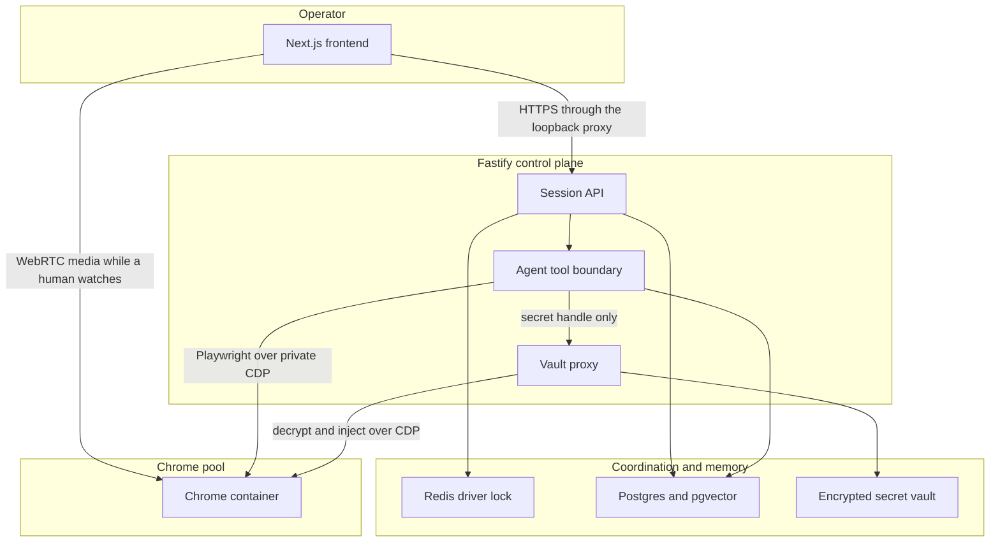

# Utomator architecture

> **The diagrams below were reconstructed from a design summary.** They should be reviewed
> against the original session before any arrow is treated as settled. Inferred transitions are
> marked in [the session-state section](./docs/architecture/arbhil.md#3-session-state-machine).

> **Status: proposal for the remote-browser design, plus a map of what the repository already
> runs.** ARBHIL is not implemented. `docs/` and this file separate existing behavior from
> proposals. A proposal does not override `AGENTS.md`.

## Mato isolation

The ARBHIL remote-browser design applies only to the mato app under `/mato/**`. Dashboard
(`/dashboard/**`, `apps/frontend/app/dashboard/**`) keeps its existing patterns, modules, design
system, growth YAML, crafts, and approvals. The public root (`/`, `apps/frontend/app/page.tsx`)
stays outside this design.

No importing the dashboard shell (`apps/frontend/modules/shell`) or dashboard modules into mato
routes. Agents working on mato must not apply dashboard invariants to browser sessions, and agents
working on the dashboard must not apply ARBHIL session rules to dashboard browser sessions.

`/mato/**` is a route scope inside the existing Next.js app (`apps/frontend/app/mato/**` when that
tree exists), not a second frontend. There is no `apps/frontend/app/mato` page in the repository
today. The shipped agent UI is the `mator` module at `apps/frontend/modules/mator`, rendered inside
dashboard pages such as `/dashboard/pipeline` and `/dashboard/settings`, with Fastify handlers in
`apps/backend/src/interface/http/mator-routes.ts`. That embedded Mator stays part of the dashboard.
The sections below describe the proposed mato app. They do not change dashboard runs.

Detail and the divergence list: [docs/architecture/arbhil.md](./docs/architecture/arbhil.md).

Utomator is a local-first automation product: a Next.js operator UI and one Fastify process that
runs allowlisted browser workflows through Playwright. The proposed mato design on this page is
**Agent-Operated Remote Browser with Human-in-the-Loop (ARBHIL)**: an AI agent drives a remote
Chrome, a human can watch and take over at any time, and user secrets stay out of the agent
context. It applies under `/mato/**` only.

## What runs today

```text
apps/frontend   Next.js operator UI. The browser reaches Fastify only through
                apps/frontend/app/api/[...path]/route.ts
apps/backend    Fastify 5, one Runner, Playwright Chromium, Drizzle
```

The control plane binds to `127.0.0.1`. CDP endpoints must be loopback
(`apps/backend/src/infrastructure/browser/provider.ts`). Chromium is imported only by that
provider. Connect sessions and run sessions are different instances. Workflow plans stay linear:
`start → session → action → finish`. Mutating runs need human approval and read-back.

The durable product map is the [documentation index](./docs/README.md). Hosted deployment as it
exists is a single-node OIDC gateway, documented in
[hosted tenancy](./apps/backend/docs/hosted-tenancy-architecture.md). Growth, Craft, and the
execution engine are described in
[the unified workflow proposal](./docs/architecture/unified-growth-workflow-engine.md).

## ARBHIL mental model

This is the proposed `/mato/**` app. A person asks mato to do something in a signed-in website. The
Fastify control plane gives the agent a browser and a memory, and withholds passwords, addresses,
and other secrets. The agent names a secret by handle. A vault proxy decrypts it and types it into
the page. The person can open a live view, take the controls, and hand them back. While nobody is
watching, Chrome stays headless so the session does not pay for a video stream. Dashboard pages
under `/dashboard/**` keep the runner described in "What runs today".



This flowchart is the same diagram as in the detailed design and in
`docs/architecture/diagrams/15-arbhil-control-plane.mmd`.

## Where the detail lives

| Topic | Section |
| --- | --- |
| Overview and mental model | [Overview](./docs/architecture/arbhil.md#1-overview-and-mental-model) |
| High-level architecture | [Control plane](./docs/architecture/arbhil.md#2-high-level-architecture) |
| Session state machine | [States and transitions](./docs/architecture/arbhil.md#3-session-state-machine) |
| Agent drive, takeover, vault injection | [Sequences](./docs/architecture/arbhil.md#4-behavioral-sequences) |
| Encrypted secrets and threat model | [Secret vault](./docs/architecture/arbhil.md#5-secret-vault) |
| Headless default, idle reclaim, adaptive video | [Cost controls](./docs/architecture/arbhil.md#6-cost-controls) |
| Stack, proposed and present | [Technology stack](./docs/architecture/arbhil.md#7-technology-stack) |
| Warm pool, affinity, autoscaling | [Deployment](./docs/architecture/arbhil.md#8-deployment) |
| Conflicts with this repository | [Open questions and divergences](./docs/architecture/arbhil.md#open-questions-and-divergences) |

Standalone Mermaid sources for the figures are listed in the
[diagram library](./docs/architecture/diagrams/README.md).
