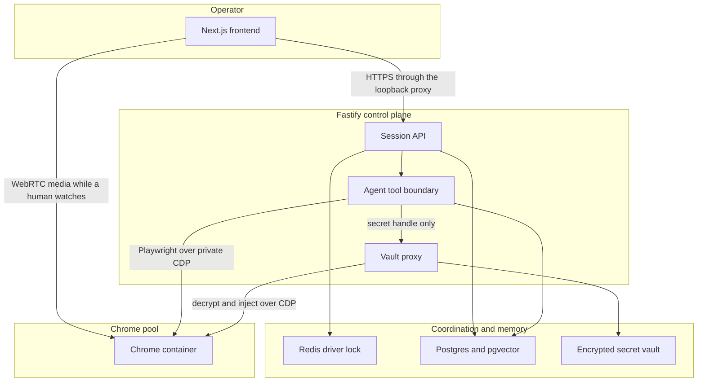
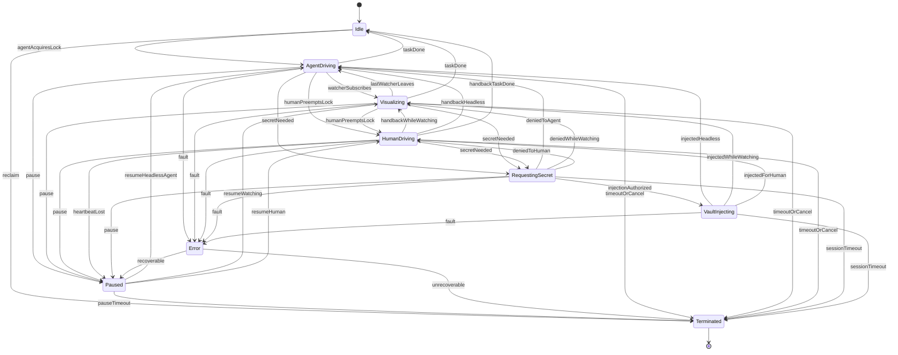
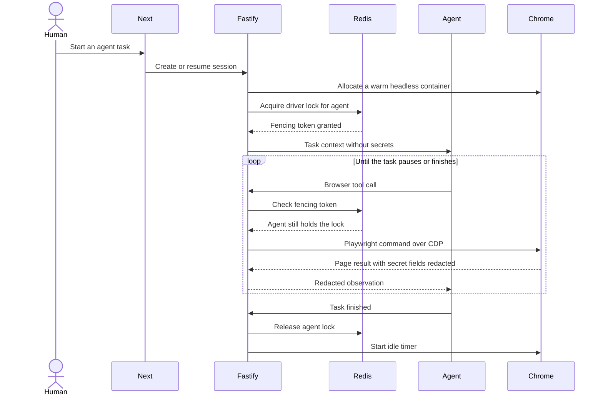
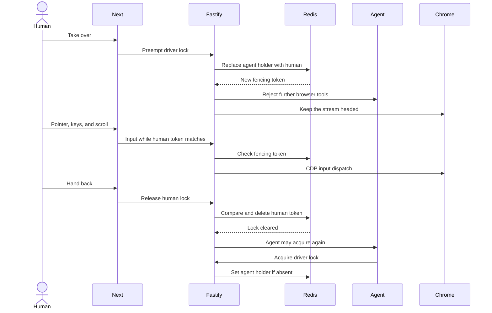
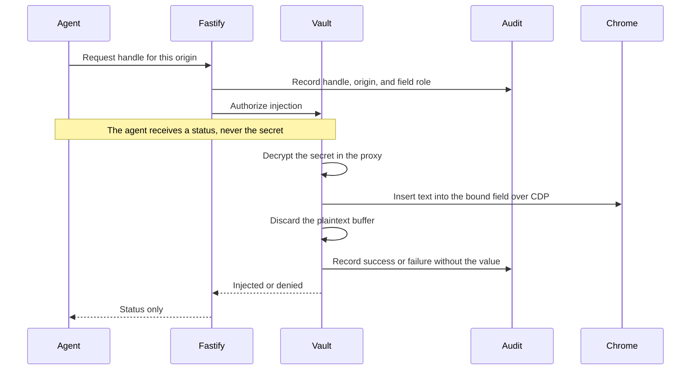
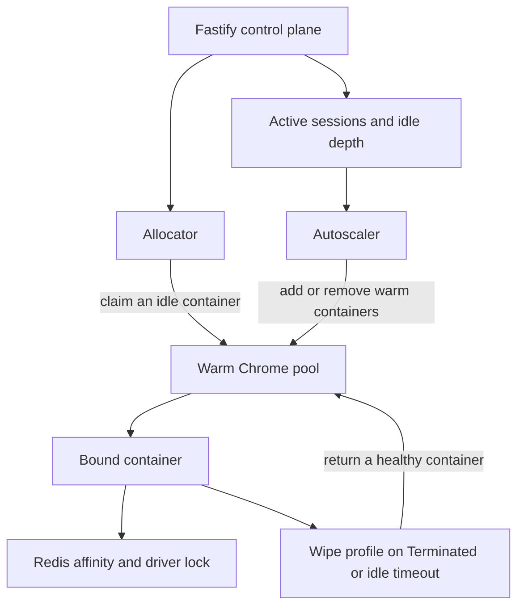

# Agent-Operated Remote Browser with Human-in-the-Loop (ARBHIL)

> **Status:** Proposed design. Not implemented.
> **Date:** 12 November 2026.
> **Entry point:** [ARCHITECTURE.md](../../ARCHITECTURE.md).

> **The diagrams in this document were reconstructed from a design summary.** They should be
> reviewed against the original session. Transitions marked **Inferred** in the tables below were
> added so the machine has pause, fault, timeout, and terminal behavior. They were not named as
> arrows in the summary. Standalone copies live under
> [docs/architecture/diagrams](./diagrams/README.md). If a figure changes, update the Markdown fence
> and the matching `.mmd` file together.

## Mato isolation

The ARBHIL remote-browser design applies only to the mato app under `/mato/**`. Dashboard
(`/dashboard/**`, `apps/frontend/app/dashboard/**`) keeps its existing patterns, modules, design
system, growth YAML, crafts, and approvals. The public root (`/`, `apps/frontend/app/page.tsx`)
stays outside this design.

No importing the dashboard shell (`apps/frontend/modules/shell`) or dashboard modules into mato
routes. Agents working on mato must not apply dashboard invariants to browser sessions, and agents
working on the dashboard must not apply ARBHIL session rules to dashboard browser sessions.

`/mato/**` is a route scope inside the existing Next.js app (`apps/frontend/app/mato/**` when that
tree exists), not a second frontend. There is no `apps/frontend/app/mato` page in the repository
today. The shipped agent UI is the `mator` module at `apps/frontend/modules/mator`, rendered inside
dashboard pages such as `/dashboard/pipeline` and `/dashboard/settings`, with Fastify handlers in
`apps/backend/src/interface/http/mator-routes.ts`. That embedded Mator stays part of the dashboard.
Everything after this section is the proposed mato app. It does not change dashboard runs.

The agent rule is [AGENTS.md](../../AGENTS.md) under "Mato isolation".

This design does not replace the run lifecycle already drawn in
[09-run-state-machine.mmd](./diagrams/09-run-state-machine.mmd). A workflow run still moves through
`running`, `paused`, `input-needed`, `approval-needed`, `completed`, `blocked`, `failed`, and
`cancelled`. ARBHIL describes a different question: who is allowed to drive a remote Chrome, and
where a secret goes when the page asks for one.

## 1. Overview and mental model

ARBHIL is a remote browser for the mato app under `/mato/**`, with two drivers and a blind spot
for secrets. Dashboard routes under `/dashboard/**` keep the run lifecycle above.

The **agent** is the default driver. It sees the page the way an automation client does: URL,
structure, and text that the tool boundary is willing to return. It decides the next click, type,
or navigation, and it calls Playwright through the Fastify control plane. It never receives a
password, an address, or any other vault value as text.

The **human** can watch that browser at any moment and can take the pointer and keyboard. Taking
over is preemptive. The agent stops affecting the page until the human hands control back. Handing
back is explicit. A dropped watch session does not silently return the keyboard to the agent.

**Secrets** (credentials, postal addresses, and other values the user stored for injection) are
encrypted at rest. The agent refers to them by handle. A **vault proxy** inside the control plane
is the only component that decrypts a value, and it writes that value into the page with CDP. The
tool result that goes back to the agent is a status.

Chrome runs **headless** unless a person is subscribed to the live view. The live view is a WebRTC
stream of the same browser the agent is driving, not a second browser and not a copy of the page.

Three rules keep this aligned with the product that is already in the repository:

- One Fastify process remains the control plane. The Next.js app reaches it through the loopback
  proxy at `apps/frontend/app/api/[...path]/route.ts`.
- A mutating workflow still needs human approval and read-back. Taking the browser controls is not
  an approval decision. A blocked run is not a success. A draft is not a published post.
- `RunSummary.state = 'completed'` does not mean the browser session is idle, and a connect session
  is not a run session. ARBHIL session state is a third record.

## 2. High-level architecture

| Piece | Responsibility |
| --- | --- |
| Next.js frontend | Operator UI. Starts tasks, renders the watch surface, sends takeover and handback, and sends pointer and keyboard input while the human is the driver. |
| Fastify control plane | Authenticates the caller, owns session state, checks the driver lock before every browser effect, and hosts the agent tool boundary and the vault proxy. |
| Agent tool boundary | Accepts high-level browser actions and secret handles. Rejects raw CDP from the model. Redacts secret field values out of observations. |
| Chrome container | One Chrome for the session. Playwright connects over a private CDP endpoint. The same browser is headless or streamed. |
| WebRTC | Media path to the operator's device while the session is `Visualizing` or `HumanDriving`. Signaling stays on the authenticated API. The media path carries pixels, not vault payloads. |
| Redis | Ephemeral driver lease and session-to-container affinity. Postgres holds the durable session row. |
| Postgres and pgvector | Durable session state, audit records, and agent memory (notes and embeddings). |
| Vault and vault proxy | Encrypts user secrets at rest. Decrypts only inside the proxy, then injects over CDP. |

The agent's memory is allowed to store task notes, page observations the tool boundary already
returned, and embeddings of those notes. It is not a second copy of the vault. Writes pass the
same style of secret rejection already used by `ActivityMemory` in
`apps/backend/src/infrastructure/mator/mator-activity-memory.ts`.

## 3. Session state machine

`Visualizing` means the agent still holds the driver lock and at least one human is watching.
`HumanDriving` means the human holds the lock, which implies the stream is up. `AgentDriving`
means the agent holds the lock and nobody is watching, so Chrome is headless.

`RequestingSecret` and `VaultInjecting` do not transfer the lock. They record `resumeState` as
`AgentDriving`, `Visualizing`, or `HumanDriving`, and they return there. `Paused` records the same
kind of resume target.

A pause requested during `VaultInjecting` waits until the injection call returns. That matches the
current runner, which applies an external pause at the next safe boundary rather than in the
middle of a click or an approval.

### States

| State | What is true | Driver lock | Chrome |
| --- | --- | --- | --- |
| Idle | The session record exists and nobody is driving. A warm container may already be reserved, or allocation has not happened yet. | none | headless, not streamed |
| AgentDriving | The agent holds the lock and may send Playwright commands. | agent | headless |
| Visualizing | At least one human subscriber is attached. The agent still drives. Human input is not applied to the page. | agent | headed, WebRTC on |
| HumanDriving | The human holds the lock. Agent browser tools are rejected. | human | headed, WebRTC on |
| RequestingSecret | A handle is waiting on policy or on an explicit human approval. `resumeState` remembers who was driving. | unchanged | unchanged |
| VaultInjecting | The proxy holds plaintext for the duration of one injection call. Screenshots and evidence captures are suppressed. | unchanged | unchanged |
| Paused | Browser tools and human input are frozen. The lock stays with the previous holder. Resume uses the stored target. | unchanged | stream stays only while a watcher is still attached |
| Error | A fault is recorded. A recoverable fault moves to `Paused`. An unrecoverable fault moves to `Terminated`. | held until the recovery edge | stream stops if the fault is unrecoverable |
| Terminated | The lock is released, WebRTC is closed, plaintext buffers are discarded, and the container is reclaimed. | none | profile wiped, container returned or destroyed |

### Transitions

| From | Event | To | Effect | Source |
| --- | --- | --- | --- | --- |
| Idle | `agentAcquiresLock` | AgentDriving | Allocator binds a container. Redis `SET` of the agent lease succeeds only if the key is absent. | Summary |
| Idle | `reclaim` | Terminated | Nothing is bound, or the reservation outlived its idle budget. | Inferred |
| AgentDriving | `watcherSubscribes` | Visualizing | Start the headed stream for that subscriber. Lock stays with the agent. | Summary |
| Visualizing | `lastWatcherLeaves` | AgentDriving | Stop WebRTC and return to headless. The agent keeps driving. | Summary |
| AgentDriving | `humanPreemptsLock` | HumanDriving | Human lease replaces the agent lease. Agent tools start failing closed. Stream starts if it was off. | Summary |
| Visualizing | `humanPreemptsLock` | HumanDriving | Same preemption while the stream is already up. | Summary |
| HumanDriving | `handbackWhileWatching` | Visualizing | Compare-and-delete the human token, then the agent may hold the lock again. The subscriber stays. | Summary |
| HumanDriving | `handbackHeadless` | AgentDriving | Handback when the human also leaves the stream and the task is still open. | Inferred |
| HumanDriving | `handbackTaskDone` | Idle | Handback when the agent has no further work. | Inferred |
| AgentDriving | `taskDone` | Idle | Agent releases the lock. Idle timer starts. | Summary |
| Visualizing | `taskDone` | Idle | Task ends while someone is still watching. Stream closes with the session going idle. The watcher must subscribe again if a new task starts. | Inferred |
| AgentDriving, Visualizing, or HumanDriving | `secretNeeded` | RequestingSecret | The tool call names a handle, an origin, and a field role. No secret bytes are copied into the agent context. | Summary |
| RequestingSecret | `injectionAuthorized` | VaultInjecting | Policy and, where required, a human approval allow injection. | Summary |
| RequestingSecret | `deniedToAgent`, `deniedWhileWatching`, or `deniedToHuman` | The stored `resumeState` | Denial, cancellation, or approval timeout. The agent sees a status. | Summary, three arrows are the resume targets |
| VaultInjecting | `injectedHeadless`, `injectedWhileWatching`, or `injectedForHuman` | The stored `resumeState` | Proxy finishes or fails the CDP insert, wipes its buffer, and writes an audit row. | Summary, three arrows are the resume targets |
| AgentDriving, Visualizing, HumanDriving, or RequestingSecret | `pause` | Paused | Freeze input and agent browser tools. A pause asked for during `VaultInjecting` waits until that call returns, then pauses. | Inferred, aligned with the current safe-boundary pause |
| HumanDriving | `heartbeatLost` | Paused | The watch or input channel died. The agent does **not** receive the lock as a side effect. | Inferred |
| Paused | `resumeHeadlessAgent`, `resumeWatching`, or `resumeHuman` | The stored resume target | The lock holder continues. A resume into `HumanDriving` or `Visualizing` requires a live subscriber. | Inferred |
| Paused | `pauseTimeout` | Terminated | The pause outlived its budget. | Inferred |
| AgentDriving, Visualizing, HumanDriving, RequestingSecret, or VaultInjecting | `fault` | Error | Browser crash, CDP loss, vault decrypt failure, or a failed lock renewal. | Inferred |
| Error | `recoverable` | Paused | The container is still usable, or a replacement container was bound and the profile restored without copying secrets into the agent. | Inferred |
| Error | `unrecoverable` | Terminated | The session cannot continue safely. | Inferred |
| AgentDriving, Visualizing, HumanDriving, RequestingSecret, or VaultInjecting | `timeoutOrCancel` or `sessionTimeout` | Terminated | Owner cancel, idle timeout, or an injection that never returned. | Inferred |
| Terminated | session record closed | terminal | Reclaim path in the deployment section. | Inferred |

The Redis lease is a fencing token, not the session history. The durable row in Postgres stores
the state name, the resume target, the container id, and the holder role. If the lease key is
missing while Postgres still says a driver is active, the control plane treats the session as
`Paused` until a holder acquires a new token. That keeps Redis from becoming a second source of
truth for workflow history. The [unified engine proposal](./unified-growth-workflow-engine.md)
already requires that Redis not become a competing state authority.

## 4. Behavioral sequences

### Agent drive

The agent acquires the lock, drives through the tool boundary, and releases the lock when the task
ends. Every Playwright call re-checks the fencing token so a stale agent loop cannot type after a
human has taken over.

Lease shape, proposed:

| Field | Value |
| --- | --- |
| Key | `arbhil:session:{sessionId}:driver` |
| Value | holder role (`agent` or `human`), holder id, fencing token |
| Acquire | `SET` only if the key is absent, with a TTL the holder renews by heartbeat |
| Release | compare-and-delete on the fencing token |
| Agent after a human | `SET` only if absent. The agent cannot overwrite a human token |

### Human takeover and handback

The human may replace an agent lease. The agent may not replace a human lease. Release is
compare-and-delete so an old agent response cannot delete the human's key.

Input that arrives without the current human token is dropped. After handback, the next state is
`Visualizing` if the subscriber remains, `AgentDriving` if the task is open and nobody is
watching, or `Idle` if the task is finished.

### Vault injection

The agent asks for a handle. The proxy checks that the handle is allowed on the page's origin,
decrypts in its own buffer, inserts through CDP, and returns a status. The sequence is the same
whether the driver is the agent or the human. A human-driven injection is how a person asks the
product to fill a stored address without pasting it into the chat.

## 5. Secret vault

The vault stores **user secrets the product types into pages**: passwords, addresses, and similar
values. Each record is bound to an owner and to the origins where injection is allowed.

This is a different store from the connector session vault already implemented in
`apps/backend/src/infrastructure/connect/session-vault.ts`. That module encrypts a provider session
(cookies, origin storage, browser hints) for LinkedIn and X. ARBHIL does not fold passwords into
that payload. The [LinkedIn vault connector design](../superpowers/specs/2026-10-29-linkedin-vault-connector-design.md)
still says the user's password is typed only into the provider page and is not the durable
credential.

### At rest

| Property | Proposal |
| --- | --- |
| Cipher | AES-256-GCM, the same construction the connector session vault already uses |
| Key | Master key from the environment. Per-owner subkey via HKDF-SHA256, so one tenant's key does not open another tenant's records |
| Record | Handle id, owner id, origin allowlist, field purpose, ciphertext, IV, auth tag, version. Plaintext is not a column |
| Handle | Opaque id the agent and the UI can store in a plan. The handle is not an encryption of the secret and is not the secret |
| Missing key | Injection is disabled with an explicit capability error. The product does not fall back to a plaintext file |

Both Drizzle schemas (`schema-sqlite.ts` and `schema-postgres.ts`) change together if this record
becomes a table. Until then it stays a proposal.

### Injection path

1. The caller presents a handle, the current page origin, and a field role (for example the
   password input on a specific host).
2. The control plane checks owner, origin allowlist, session state, and driver lock.
3. Where policy requires it, the human approves. Approval timeout returns to `resumeState` with
   status `denied`.
4. The proxy decrypts into a short-lived buffer. That buffer is not logged, not written to the run
   journal, and not placed on the agent tool result.
5. The proxy inserts the text with CDP into the matched field and then discards the buffer.
6. An audit row records owner, session, handle, origin, field role, actor (agent or human), result,
   and time. The row has no secret value and no DOM dump.

Observations returned to the agent omit values of nodes tagged as secret targets. Password inputs
stay masked on the WebRTC picture. Evidence screenshots are skipped for the injection call, which
is the rule already stated on `attemptLogin`: credentials exist only for the active request, and
login screens are not captured as evidence.

### Audit

Audit rows live in Postgres with the session, not in the model context. The existing run journal
(`.runtime/runs/*.jsonl`) remains the workflow event log. Vault audit is additive. A journal line
may say that a handle was injected. It may not quote the value.

### Threat model

| Threat | What the design relies on | Residual risk |
| --- | --- | --- |
| The model is prompted to print the password | No tool returns secret bytes. Handles are the only reference in the prompt and the plan | A bug that puts the proxy buffer on a tool result breaks the guarantee |
| The model sends raw CDP and reads `element.value` after a fill | The agent has no raw CDP passthrough. Reads of secret-tagged nodes are stripped | An allowlist hole, or a field the proxy failed to tag, leaks into the observation |
| Logs, screenshots, or memory notes keep the secret | Audit and journals store handles. `VaultInjecting` suppresses screenshots. Memory writes reject secret-shaped text | A site that echoes the secret into visible page text can still be observed |
| Injection into an attacker origin | The handle is origin-bound. The proxy checks the live page origin before CDP insert, the same class of check `attemptLogin` uses for official hosts | A too-broad origin list on the secret record |
| WebRTC or the watch UI becomes a secret channel | Media is pixels. Signaling does not carry vault payloads. Masked password fields stay masked | The site's own reveal control can put the text on screen in front of the human, which is the human's action |
| Another tenant reads the record | Owner id is part of the key derivation and the primary lookup. The hosted gateway already refuses cross-owner ids | Host process compromise, which the current hosted doc already treats as out of scope for process isolation |
| Redis lock theft or a stale agent | Human preemption issues a new fencing token. Release is compare-and-delete. A missing lease pauses the session | A stolen human session cookie is a stolen driver. Session auth stays with the existing OIDC gateway in hosted mode |
| Proxy and agent share a machine | The proxy is a module boundary inside the one Fastify process, which is what `AGENTS.md` allows | Same-process memory is visible to a compromised runtime. A separate vault service would be a second deployable and is not part of this proposal |
| Backup of the database | Backups store ciphertext | The master key and the database must not be backed up as one unprotected bundle |

## 6. Cost controls

Headless is the default. The stream exists only while the session is `Visualizing` or
`HumanDriving`. Leaving the last watcher fires `lastWatcherLeaves` and returns Chrome to headless
without stopping the agent's task.

| Control | Behavior |
| --- | --- |
| Headless default | Containers in the warm pool and sessions in `Idle`, `AgentDriving`, `Paused` without a watcher, `Error`, and `Terminated` do not encode video |
| Stream on demand | `watcherSubscribes` is what starts WebRTC. `beginView` is not tied to mere allocation |
| Idle reclaim | `Idle` and `Paused` have budgets. On expiry the state becomes `Terminated`, the profile directory is wiped, and a healthy container returns to the warm pool |
| Active budget | A session that stays `AgentDriving` with no progress heartbeat is a fault, then `Terminated`, so a stuck agent cannot hold a container indefinitely |
| Warm pool cap | The autoscaler keeps a small idle set and refuses new sessions past the configured maximum. Today's hosted knob for this idea is `HOSTED_MAX_WORKERS` |
| Adaptive WebRTC | While a subscriber is attached, the sender reduces resolution, frame rate, and bitrate when the client reports a narrow link or a small viewport. Mobile and low-end devices get a smaller layer rather than a full desktop encode |
| Sign-in budget | Connector sign-in already uses a 10-minute single-use ticket (`TICKET_TTL_MS` in `stream-tickets.ts`). ARBHIL session budgets are separate timers and must not reuse that ticket as a driver lock |

Pixels are the expensive part. CDP commands in a headless session stay cheap relative to a
continuously encoded stream, which is why the state machine treats "someone is watching" as its
own state.

## 7. Technology stack

| Layer | ARBHIL proposal | In this repository today |
| --- | --- | --- |
| Operator UI | Next.js | Next.js 16, `apps/frontend` |
| Control plane | Fastify | Fastify 5, `apps/backend`, loopback only |
| Agent | Tool-using model behind the Fastify boundary | Mator can call Groq. Browser work is an allowlisted linear plan on one `Runner`, not an open CDP loop |
| Browser control | Playwright over private CDP | Playwright. `chromium` is imported only by `infrastructure/browser/provider.ts` |
| Live view | WebRTC, adaptive bitrate, resolution, and frame rate | CDP JPEG screencast (`Page.startScreencast`). Sign-in frames go out on a ticketed WebSocket. `startScreencast` defaults to JPEG quality 60 and a 1280×800 cap |
| Driver lock | Redis fencing token | In-process `Runner.active`. A second run throws `BUSY: another browser workflow is in progress`. No Redis client in `@utomator/backend` |
| Agent memory | Postgres plus a vector extension such as pgvector | Drizzle `utomator_documents` on SQLite, or Postgres when `DATABASE_URL` is set. Chat memory is `.runtime/intelligence/chat-events.jsonl`. No vector column |
| User secrets | Encrypted handle vault and a CDP vault proxy | `connector-session-vault` for provider cookies and origin storage. Optional one-time `RunRequest.login` filled by `attemptLogin`, then wiped in the request object |
| Packaging | Docker or Kubernetes Chrome pool, scheduled by the one Fastify process | In-process headless Chromium. Hosted mode is one OIDC gateway that spawns a per-owner Fastify child. No browser-pool manifests |
| Coordination docs | Redis lease, Postgres authority | [Hosted tenancy](../../apps/backend/docs/hosted-tenancy-architecture.md) says there is no durable Redis queue or cross-node lease |

## 8. Deployment

The pool is infrastructure in front of the existing control plane. Fastify remains the only
process that accepts operator traffic. Chrome CDP stays on a network path that only that process
can open. Publishing CDP, or publishing a worker port, contradicts the hosted gateway rules.

| Mechanism | Proposal |
| --- | --- |
| Warm pool | A small number of Chrome containers are already started, headless, with empty profiles. Allocation prefers one of these over a cold start |
| Allocation | The allocator claims a warm container, binds it to a session id, and only then lets the agent acquire the driver lock |
| Session affinity | Redis holds `arbhil:session:{sessionId}:container` for the life of the lease. Postgres stores the same container id on the session row. Signaling, CDP, and input for that session go to that container |
| Autoscaling | The scaler watches active bindings and idle depth. It adds warm containers when idle depth is zero and removes warm containers above the idle target. It does not scale on WebRTC bitrate |
| Max concurrency | A configured cap rejects new sessions. `HOSTED_MAX_WORKERS` is the current single-node expression of a cap, implemented as a process limit rather than a pool |
| Cleanup | `Terminated` closes the browser context, deletes the profile directory, releases the driver lock and the affinity key, and returns the container to the warm pool if the process is healthy. A crashed container is destroyed and replaced |
| Sticky failure | If the bound container dies, the session goes to `Error`. Recovery either binds a new container and resumes from `Paused`, or terminates. It does not leave the agent holding a lock that points at a dead CDP port |

Local development stays the current path: attach to a loopback Chrome on `127.0.0.1:9222` when one
is running, otherwise a persistent headless profile under `apps/backend/.runtime/chrome`. The pool
is a hosted deployment shape. It is not required for the local operator.

## Open questions and divergences

These are places where the design summary and the repository do not say the same thing. The
summary was not edited into the code, and the code was not rewritten to match the summary.

1. **Mato route versus the embedded Mator module.** This design is scoped to a future `/mato/**`
   app. The repository has no `apps/frontend/app/mato` route. Operator pages live under
   `apps/frontend/app/dashboard/**`. The existing agent UI is `apps/frontend/modules/mator`, used
   from `/dashboard/pipeline` and `/dashboard/settings`, with HTTP in
   `apps/backend/src/interface/http/mator-routes.ts`. Applying ARBHIL states, locks, or vault
   injection to those dashboard pages would break the isolation rule. A `/mato/**` tree is not
   created by this document.

2. **WebRTC versus CDP screencast.** The approved connector design in
   `docs/superpowers/specs/2026-10-29-linkedin-vault-connector-design.md` locks streaming to CDP
   screencast over WebSocket and rejects a third-party media service and Xvfb. The implementation
   follows that: `startScreencast` in `provider.ts`, the sign-in broker in `streaming-signin.ts`,
   and `beginView` on `BrowserSession`. ARBHIL names WebRTC. Both cannot be the media path without
   an explicit decision. Adaptive quality already has a screencast-shaped control (JPEG quality and
   max width and height).

3. **Redis.** `@utomator/backend` does not depend on Redis. The hosted architecture document says
   there is no durable Redis queue or cross-node lease, and that multiple gateway replicas need a
   design that does not exist yet. The unified engine proposal says to add Redis only for a real
   coordination job and not as a second state authority. This document uses Redis as the driver
   lease and the affinity key, with the Postgres session row as the durable state. That split is a
   proposal for review, not a lease that exists in code. Today's mutual exclusion is the single
   `Runner` throwing `BUSY`.

4. **Containers and Kubernetes.** There is no Chrome pool, Dockerfile, or Kubernetes manifest for
   browsers in this repository. Hosted mode is one Linux node, an OIDC gateway, and a child Fastify
   process per owner, with headless Chromium in that process. `AGENTS.md` forbids a second server
   framework and a microservice split, and `assertLoopbackCdp` rejects non-loopback CDP. A pool
   whose CDP is reachable only from the Fastify process can be drawn without breaking those rules.
   A public CDP port, or a second control service beside Fastify, cannot. The hosted document also
   says process isolation is not container isolation against malicious native code.

5. **Two different vaults, plus a plaintext login field.** The connector session vault stores
   encrypted cookies and origin storage, not a handle catalogue of passwords and addresses.
   `RunRequest.login` still carries `identifier` and `password` into the runner, and
   `attemptLogin` fills them with Playwright in the same process before clearing the password
   field. ARBHIL's proxy assumes the agent never sees plaintext. In one process, "the agent" and
   "the proxy" share an address space unless a later change introduces a real boundary. A separate
   vault deployable would conflict with the single-process rule. That boundary is unresolved.

6. **Three state machines.** Domain `RunState` is the workflow run. `BrokerState` on the sign-in
   broker is `launching`, `streaming`, `authenticated`, and `closed`. ARBHIL adds Idle,
   AgentDriving, HumanDriving, Visualizing, RequestingSecret, VaultInjecting, Paused, Error, and
   Terminated for the remote browser. Collapsing them would hide the existing rule that a
   completed run summary is not an idle runner, and that connect sessions and run sessions are
   different instances.

7. **Memory.** There is no pgvector extension and no embedding table. Postgres and SQLite schemas
   are a single `utomator_documents` table. Agent memory today is a JSONL file plus the identity
   timeline. Adding a vector store means changing both schema files in one change, or leaving both
   alone.

8. **Who may preempt, and what a dead watcher means.** The summary says the human can take over at
   any time. This document infers the converse (the agent cannot preempt the human) and infers
   that a lost human heartbeat pauses instead of handing the lock back. Both inferences need to be
   checked against the original session.

9. **`Visualizing` as a state.** It is drawn as its own state so the cost controls have a single
   place to turn video on. The lock holder in that state is still the agent. If the original
   session treated "watching" as a flag on top of `AgentDriving` and `HumanDriving`, the diagram
   should be redrawn that way. The stream would still be off in headless `AgentDriving`.

10. **How the agent drives.** Current executable work is a validated linear plan
   (`start → session → action → finish`) dispatched by `Runner`. Image annotations are explicitly
   not browser clicks. ARBHIL's loop of arbitrary Playwright tool calls is a wider authority than
   the allowlisted actions. Any implementation still has to keep approval and read-back on
   mutations.

11. **Screencast already starts when a session opens.** `BrowserSession.open` calls `beginView`,
    which starts a CDP screencast and keeps the latest JPEG. That is broader than "headed only
    while a human is watching." The cost section describes the proposed narrower rule.

12. **Addresses.** Nothing in the current vault schema stores a postal address or a generic secret
    handle. The connector payload is cookies, origin storage, and browser hints for `linkedin` and
    `x`.

13. **Pool size.** The summary does not set warm-pool depth, idle timeout, or maximum concurrent
    browsers. `HOSTED_MAX_WORKERS` is the only existing cap, and it bounds child processes on one
    node.

14. **Media path and auth.** WebRTC signaling has to stay behind the authenticated gateway and the
    Next.js proxy. The summary does not specify ICE, TURN, or how a container on a private network
    reaches the operator's browser. Those details are open, and they must not become a way around
    owner checks or a way to expose CDP.

15. **Same-process secret injection.** Even with a vault proxy module, a model that can read the
    page after `locator.fill` can read a non-password field such as an address. The threat model
    requires secret-tagged nodes to be stripped from observations. That filter does not exist yet.
    Password fields filled by `attemptLogin` are the closest current behavior, and they run inside
    the runner that already held the plaintext.
