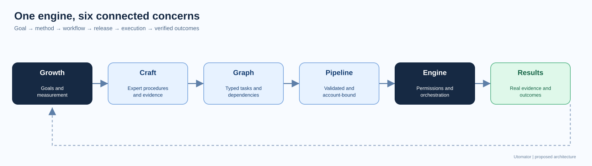
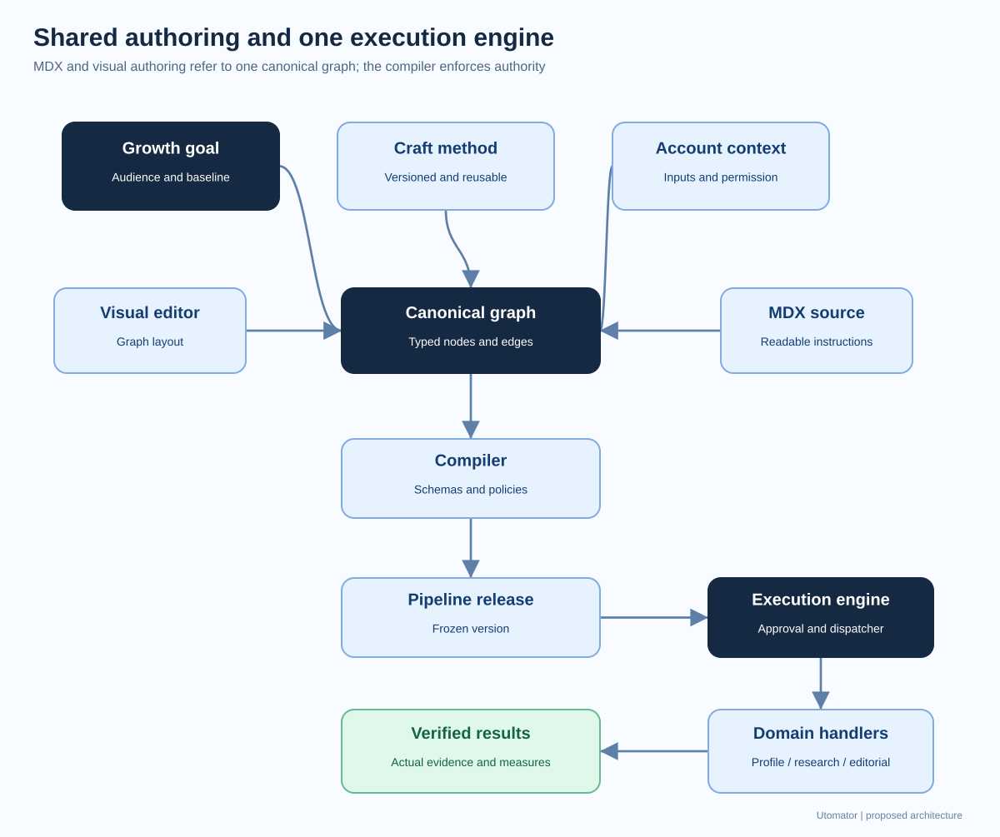
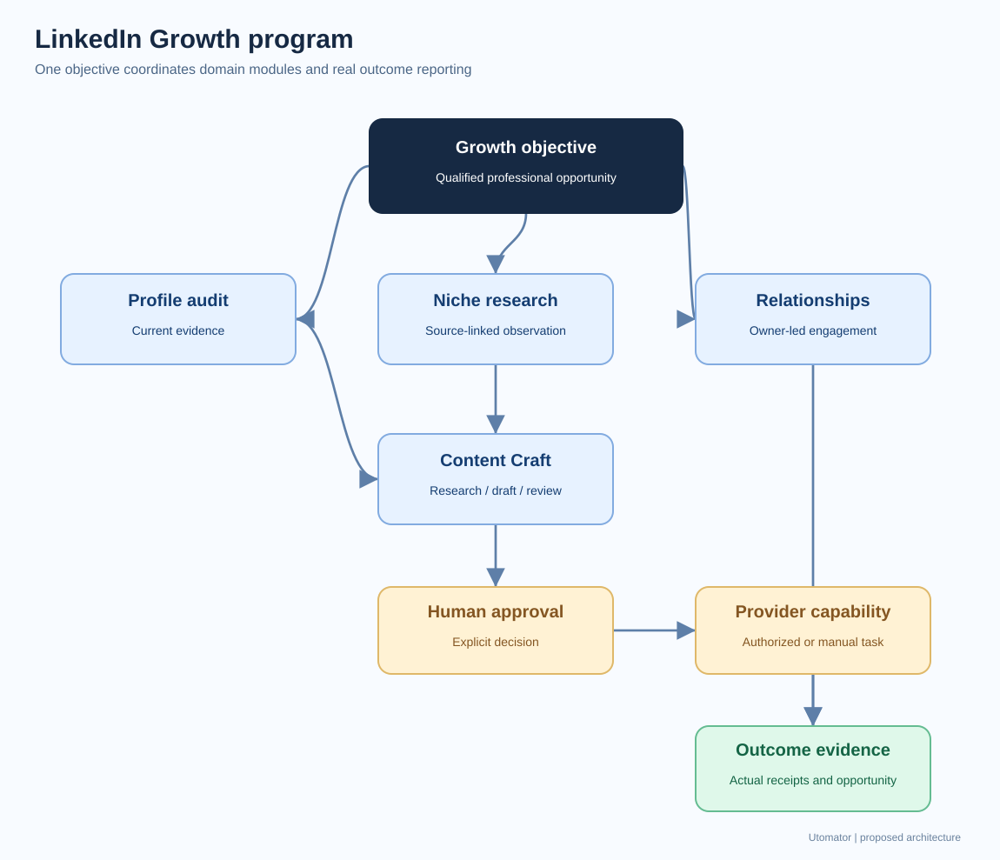
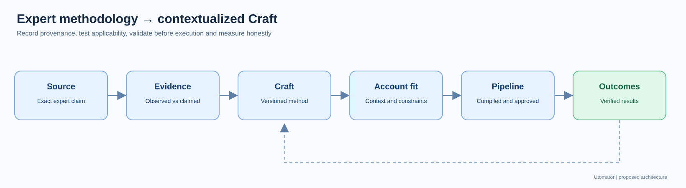
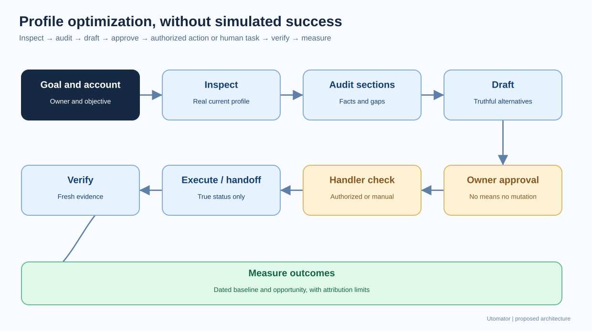

# Architecture diagram library

> **Proposed design, not implemented behavior.** All Mermaid files below are exact source copies
> from the [architecture](../unified-growth-workflow-engine.md) and
> [expert-methodology reference](../../knowledge/growth-craft-methodology.md). GitHub renders the
> fenced Mermaid diagrams in those documents as scalable vector graphics. Standalone SVGs here are
> accessible, independently drawn high-level companion illustrations, not exact one-for-one renders
> of every Mermaid edge.

| Diagram                      | Original Mermaid                                | Portable SVG companion                       |
| ---------------------------- | ----------------------------------------------- | -------------------------------------------- |
| current separation           | [source](./01-current-separation.mmd)           | View in the linked Markdown source           |
| six concepts                 | [source](./02-six-concepts.mmd)                 | [SVG](./02-six-concepts.svg)                 |
| target system                | [source](./03-target-system.mmd)                | [SVG](./03-target-system.svg)                |
| initiative workstreams       | [source](./04-initiative-workstreams.mmd)       | View in the linked Markdown source           |
| authorized operation         | [source](./05-authorized-operation.mmd)         | View in the linked Markdown source           |
| dispatcher handlers          | [source](./06-dispatcher-handlers.mmd)          | View in the linked Markdown source           |
| seven stage lifecycle        | [source](./07-seven-stage-lifecycle.mmd)        | View in the linked Markdown source           |
| linkedin growth program      | [source](./08-linkedin-growth-program.mmd)      | [SVG](./08-linkedin-growth-program.svg)      |
| run state machine            | [source](./09-run-state-machine.mmd)            | View in the linked Markdown source           |
| logical relationships        | [source](./10-logical-relationships.mmd)        | View in the linked Markdown source           |
| migration roadmap            | [source](./11-migration-roadmap.mmd)            | View in the linked Markdown source           |
| final architecture           | [source](./12-final-architecture.mmd)           | View in the linked Markdown source           |
| expert method lifecycle      | [source](./13-expert-method-lifecycle.mmd)      | [SVG](./13-expert-method-lifecycle.svg)      |
| profile optimization journey | [source](./14-profile-optimization-journey.mmd) | [SVG](./14-profile-optimization-journey.svg) |

## SVG visual references

### six concepts

### target system

### linkedin growth program

### expert method lifecycle

### profile optimization journey

## Editing rules

- The original Mermaid fences remain the authoritative diagrams. Update those and matching `.mmd`
  sources together.
- For full conditional labels, state transitions, relationship cardinalities and graph semantics,
  read the native Mermaid sources; the SVGs intentionally provide simplified executive overviews.
- No remote renderer, external asset or runtime dependency is needed to view the checked-in SVGs.
- Visual documentation does not authorize unregistered operations or imply the single engine already
  exists.
