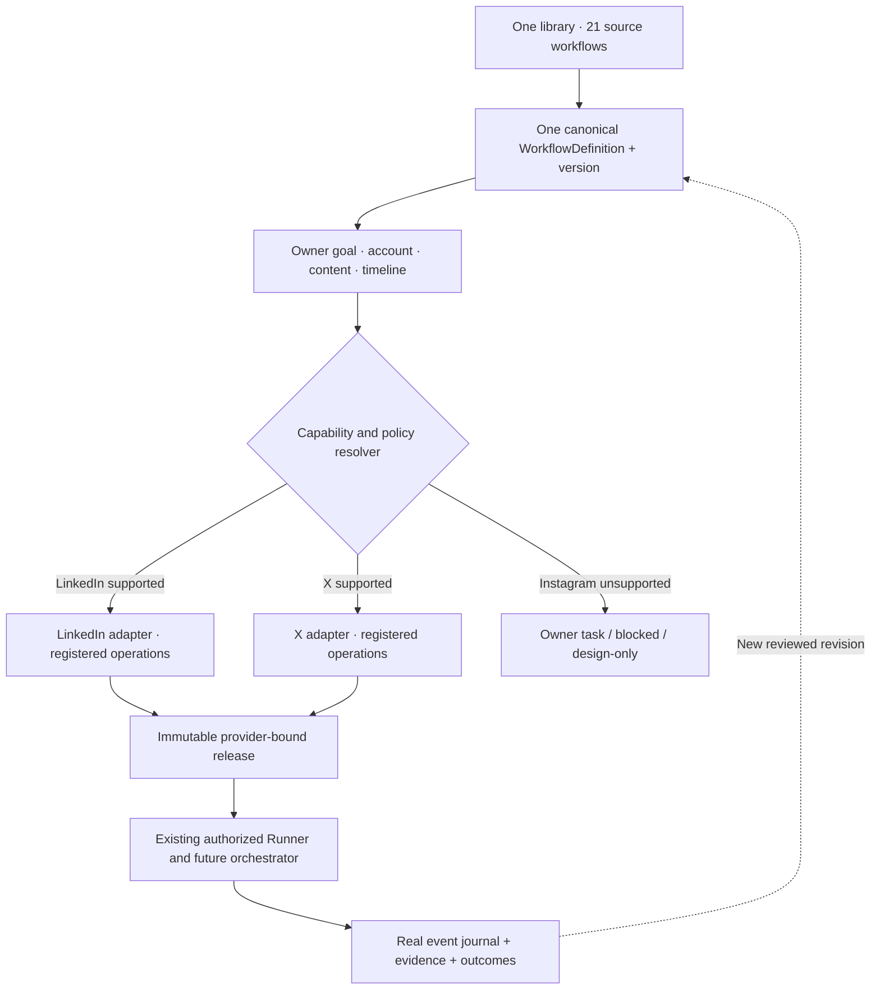
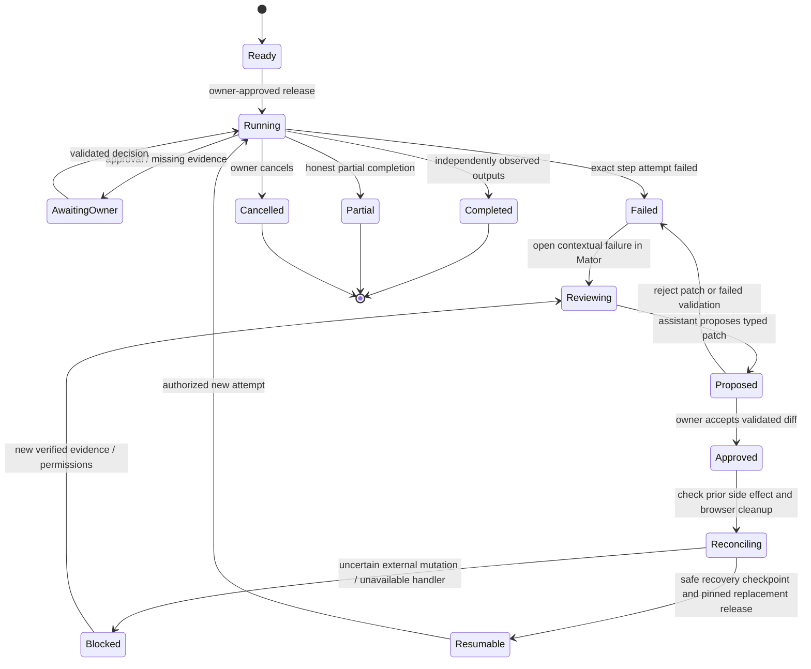

# ADR: One Growth workflow model across social platforms

> **Status:** Proposed architecture and product contract. **Not an implementation claim.**
> **Repository assessed:** `surdma/utomator`, `main` at `30b8844` and draft PR #14 at `d7fea3e` (31 October 2026).
> **Decision:** A reusable Growth method is **one versioned workflow definition**. A provider binding selects how eligible steps are carried out for a particular connected account. Templates, visual stages, pipeline releases, and runs are different **states or views of the same definition**, not competing engines.

## 1. Why the current model feels disconnected

The code confirms multiple contracts, not merely unclear navigation:

| Actual surface | Current source | What it really does | Gap |
| --- | --- | --- | --- |
| 21 Growth catalogue entries | `linkedin-growth-capabilities.ts`, six existing MDX Crafts | 15 capability descriptions and six reusable methodologies | Tied to LinkedIn labels; methodology granularity differs from a capability |
| PR #14 template browser | `template-browser.tsx`, `template-options.ts`, `GET /growth/templates` | Discovers 21 YAML entries and previews stages | A catalogue entry and a separate Growth screen still feel like distinct products |
| YAML Growth compiler | `growth-profile.ts` | Compiles two bounded read-only Runner programs; validates 19 design-only blueprints | Blueprint tasks are descriptions, not registered executable operations |
| Growth coordinator | `profile-growth-coordinator.ts` | Serial stages, pinned child plans, owner evidence, guarded advancement | Not a general DAG, adapter scheduler or durable failed-step repair engine |
| Workflow editor | `workflow-plan-editor.tsx`, `workflow-plan.ts` | Validated linear action-specific `WorkflowPlan` | Does not consume arbitrary Growth Craft MDX or blueprint YAML as executable input |
| Execution | `runner.ts`, `workflows/execute.ts` | One guarded browser Runner, recorded step events, checkpoints, cleanup | Existing terminated failures are not resumable at any arbitrary step |
| Mator | `mator-agent.ts`, `mator-actions.ts`, `mator-conversations.ts` | Conversation and constrained staged operations on saved workflow revisions | No trusted, structured Growth failure-to-repair-to-resume handshake |
| Visual graph | `growth-graph-model.ts`, `growth-workflow-artboard.tsx` | Uses actual steps, run state, failure IDs and animated React Flow edges | Node status is mostly static, and different step kinds lack appropriate inspection/dialogues |

**Do not solve the gap by adding another Growth engine, by cloning 21 definitions per provider, or by making a planning-only button appear executable.** Existing MDX Crafts, research/editorial services, saved workflow revisions and Runner approvals remain valid until proven lossless migration paths exist.

## 2. Product vocabulary and singular navigation

- **Growth goal:** The user's desired outcome and its actual baseline, audience, KPIs and time horizon. E.g. “improve professional discoverability.” This is *configuration/context*, not another execution engine.
- **Workflow:** The one canonical, versioned procedure. It defines the goal, typed stage/step graph, evidence, human checkpoints and declared capability requirements. “Profile optimization” has one identity regardless of provider.
- **Template:** A read-only, reusable starting version of that *same* Workflow. “Use template” creates a draft instance or a new revision; it must not copy a second incompatible graph.
- **Stage:** An organized group of steps and subflows. The existing “Growth pipeline node” maps to **Stage** in the user interface. A Stage is not automatically a separate executable process.
- **Step:** A specific task, procedure, observation, user decision, provider action, event, or verification. Every step has explicit inputs, outputs, UI presentation and error policy.
- **Craft:** A source-provenanced expert method referenced by workflow steps. The method does not authorize provider operations.
- **Pipeline release:** An immutable, validated workflow version resolved against *one* provider/account, available handlers, permissions and owner-approved parameters. The release is an output of compilation, not a second authoring workspace.
- **Run:** An attempt against a release with durable step attempts, event journal, approvals and evidence.
- **Mator:** A contextual assistant for understanding and proposing changes to a workflow. It cannot silently grant capabilities, overwrite approved releases or claim a broken step was fixed without validation.

**Navigation:** `Growth / Workflows` (one workspace), containing **Library**, **My workflows**, and **Runs**. Selecting a template opens the **same workflow studio** in draft/read-only preview mode. The same graph, inspector and conversation persist while a workflow moves through draft, validation, release, execution and repair. Legacy `/dashboard/growth`, `/dashboard/crafts`, `/dashboard/pipeline` and API URLs remain aliases/redirects during a tested migration; do not abruptly remove saved deep links or personal clones.

## 3. One workflow, many provider bindings

A workflow expresses **intent**, not site-specific selectors. A binding resolves its abstract operations and inputs into provider-specific, explicitly registered behaviors. The same sequence and outcome timeline can be reused where meaningful; timings, checkpoints and UI locators can vary per platform.



**Invariant:** a provider choice is not a new workflow ID. `profile-optimization@2` remains one method. `linkedin`, `x`, and `instagram` are binding choices for a particular release, possibly each with different availability. Platform-specific content limits and profile schemas are mapped explicitly; never force LinkedIn's “Experience”/“Skills” fields onto X or Instagram as nonexistent provider fields.

| General intent | LinkedIn binding | X binding | Instagram binding |
| --- | --- | --- | --- |
| Profile baseline | Allowed owner audit and supported page evidence | Existing guarded X audit, subject to account/session checks | Manual/source-backed inspection unless a genuine authorized handler is registered |
| Positioning and bio | Headline, About, Featured and applicable sections | Display name, bio, profile link, banner and permitted fields | Bio, links and visual identity with owner evidence; no assumed automated edit |
| Content planning | Drafts and approval | Drafts and approval | Drafts and approval |
| Publish/update | Only a registered, permission-checked provider operation | Only a registered, permission-checked provider operation | No button that implies automation without a supported adapter |
| Measure outcomes | Source-labeled eligible measurements | Source-labeled eligible measurements | Source-labeled eligible measurements; unavailable data remains unknown |

The initial 21 IDs remain stable for compatibility. The **15 capability definitions** and **six MDX expert methodologies** should be reviewed for semantic overlap rather than flattened into 21 equally executable steps. A methodology can be referenced by multiple workflows; a workflow can reference multiple Crafts. Migration must preserve the original 107 proposed action descriptions and six source histories without relabelling proposals as verified operations.

## 4. Proposed canonical definition contract (v2, not currently parsed)

The existing restricted YAML parser accepts a fixed mapping shape; the example below is a **target schema**, not input supported by today's compiler. New schemas must be parsed and validated separately, with explicit v1 migration, before use.

```yaml
apiVersion: utomator.dev/v2
kind: WorkflowDefinition
metadata:
  id: profile-optimization
  version: 2
  title: Profile optimization
  origin: built-in-growth
intent:
  outcome: Evidence-backed professional profile improvement
  indicators:
    - profile-completeness-reviewed
    - qualified-conversations-source-verified
  timeline:
    baseline: before-work
    followup: after-owner-approved-changes
providers:
  linkedin:
    capabilities:
      inspect: linkedin.profile.audit
      edit: linkedin.profile.edit  # resolve only if this exact operation is registered
  x:
    capabilities:
      inspect: x.profile.audit
      edit: x.profile.edit         # resolve only if registered and authorized
  instagram:
    capabilities:
      inspect: manual.owner-evidence
      edit: manual.owner-handoff
stages:
  baseline:
    title: Inspect available evidence
    steps:
      read-profile:
        kind: observe
        requires: profile.inspect
        input: { account: '$context.account' }
        output: profile-evidence/v1
        interaction: evidence-viewer
  propose:
    dependsOn: [baseline]
    title: Prepare truthful revisions
    steps:
      evaluate:
        kind: procedure
        uses: craft.profile-positioning@1
        input: { baseline: '$stages.baseline.read-profile.output' }
        output: revision-proposal/v1
        interaction: evidence-comparison
      approve:
        kind: approval
        input: { proposal: '$steps.evaluate.output' }
        interaction: approval-diff
  apply:
    dependsOn: [propose]
    title: Apply only authorized changes
    steps:
      update:
        kind: provider-action
        requires: profile.edit
        approval: '$steps.approve.decision'
        interaction: action-review
        retry: reconcile-before-retry
  verify:
    dependsOn: [apply]
    title: Reinspect and report
    steps:
      compare:
        kind: verify
        input: { before: '$stages.baseline.read-profile.output' }
        interaction: outcome-comparison
```

The example's `providers.*.capabilities` names are **hypothetical bindings** until registered. No YAML value may contain arbitrary scripts, CSS selectors, JavaScript, shell commands, unsanitized HTML, or URLs supplied as an execution authority. Provider adapters, not the AI model, own Playwright locators, browser session checks, navigation, observed UI compatibility and read-back validation. Failing locators must produce an explicit, attributable error rather than an invented success.

### Required runtime structures

| Record | Minimum required fields and invariants |
| --- | --- |
| Definition | Stable `workflowId`, immutable `version`, `sourceDigest`, typed input/output schemas, stage/step IDs and dependencies; no provider account IDs |
| Provider binding | `platform`, `capability`, `handlerId`, `handlerVersion`, allowed field mapping, policies, human fallback, actual availability |
| Instance | `workflowId`, draft revision, `ownerId`, goal, audience, selected provider/account, supplied input, schedule/baseline |
| Release | Frozen definition digest, binding registry version, explicit account/tenant scope, verified permissions, parameters and approvals |
| Step attempt | `runId`, `stageId`, `stepId`, attempt number, handler version, input/output digests, state, timestamps, error code and evidence refs |
| Failure | Exact step + attempt, error classification, safe public diagnostic, restricted underlying details, retryability, reconciliation requirement |
| Recovery proposal | Parent failure ID, expected current workflow revision, structured diff, validation result and owner decision; never auto-applied |
| Outcome | Real receipts or owner-supplied/unverified evidence, time window, baseline and attribution limitations |

**Compile-time checks:** reject missing provider bindings, unknown handlers, invalid input/output references, cycles, conflicting account ownership, unbounded retries, incompatible stage outputs and unsupported mutation requirements. For a non-executable method, provide a **manual or design-only** mode rather than silently substituting an imaginary provider action.

## 5. Step-specific interactions, not generic controls

The graph is the main navigation surface; the **selected step owns the inspector's interaction contract**. Do not show identical unrelated buttons and input boxes for every node. A step can ask a question only when a required datum is actually missing.

| Step kind | Primary presentation | Allowed interaction | Completion evidence |
| --- | --- | --- | --- |
| `todo` / manual task | Owner checklist, context and due date | Mark done with actual owner attestation | Explicit owner-supplied status |
| `procedure` / `craft` | Method, inputs, source and results | Review source, inspect dependent evidence | Structured derived artifact, not provider claim |
| `observe` | Captured page, extracted fields, timestamp | Open evidence, re-inspect if permitted | Snapshot and typed observation |
| `decision` | Condition and evaluated values | Inspect why branch selected | Recorded branch and inputs |
| `approval` | Before/after diff and risks | Approve/reject exact version | Owner decision and digest |
| `provider-action` | Operation, account, scope, change set | Confirm then run (only if capability resolved) | Provider receipt + read-back, or `uncertain` |
| `event` / wait | Timer, trigger or external dependency | Inspect event, defer/cancel when authorized | Trigger event with source, not fabricated progress |
| `verify` | Evidence comparison | Confirm provenance and differences | Verified result or explicit mismatch |
| `failure` | Failed step, attempt, reason and context | **Explain in Mator**, retry if *safe* | New validated attempt or continued failure |

**Dialog pattern:** a single contextual inspector or dialog whose title, body, controls and footer come from an allowlisted `interaction` registry keyed by step kind/capability. The YAML selects a registered interaction name and constrained, validated form schema; it cannot inject arbitrary components. Use shadcn Dialog/Drawer for depth, Accordion for nested evidence, Questionnaire for genuinely multi-step clarification, and persistent inline details for simple observation. Close/back returns to the same focused node. Controls are disabled with explanatory text when no supported handler or permission exists.

**Graph motion:** graph edges may animate **only while the corresponding transition is genuinely active**, with reduced-motion fallback. Nodes get restrained 150–250 ms status transitions (`waiting → active → completed`, `failed`, `blocked`); a failed node pulses briefly and then remains visibly red with icon and error label. Persisted state controls animation, not optimistic frontend timers. Parent stage derives status from the actual child attempts, and the selected child is scrolled/focused into view. Avoid infinite decorative animations, positional layout jumps or color-only meaning.

## 6. Failure → Mator → validated repair → continue

A failed step must **not** be treated as a conversational failure that can be fixed by generating a cheerful message. It is an execution checkpoint with a specific error and durable evidence.



**Failure event contract:**

```json
{
  "type": "workflow.step.failed",
  "runId": "run-id",
  "releaseId": "frozen-release-id",
  "workflowId": "profile-optimization",
  "platform": "linkedin",
  "stageId": "baseline",
  "stepId": "read-profile",
  "attempt": 1,
  "error": { "code": "LOCATOR_NOT_FOUND", "summary": "Profile heading was not found", "recoverable": true },
  "snapshotRefs": ["redacted-evidence-id"],
  "state": "failed"
}
```

Only trusted backend events can create this record. Mator receives a **reference to the authenticated, owner-scoped failure**, not an editable user-supplied `runId` string. The chat opens the right workflow thread, shows the actual failed stage/step and evidence, and may propose a constrained change: update an allowed parameter, fix an inspector mapping through a reviewed handler version, request owner evidence, or choose manual handoff. `validatePlan`/new v2 compiler checks the proposed patch and permissions; the UI shows its before/after diff and requires explicit approval. The resulting release is new and immutable. Existing run artifacts remain untouched.

**Safe recovery:** distinguish (1) transient read-only failures eligible for bounded retry, (2) bad configuration requiring a revised release, (3) missing authentication or permission requiring an owner checkpoint, (4) provider/API changes requiring adapter code/test changes, and (5) **uncertain external mutations requiring read-back reconciliation before any retry**. Do not retry `publish`, `delete`, `invite` or profile edits until the previous side effect is known. Preserve completed upstream outputs only when their digests, account binding and handler versions are compatible. If not, restart the approved workflow from the required earlier stage. Existing `Runner.resume()` is a **paused-run** feature, not proof that a terminated failed step is resumable. A new coordinator recovery transition and storage contract must exist before the UI offers “Resume from failed step.”

**Bounded iteration:** retries need a per-step budget, exponential backoff, cancellation and an audit trail. Example default for idempotent read-only work: at most three attempts, and stop for human review if still failing. A human may approve a later revision/attempt; never run an unbounded LLM-edit-retry loop. The UI must show the old failure, proposed fix, validation, approval, fresh attempt and final verified state.

## 7. Shared UI journey

1. Choose **Workflows**; search the 21 method definitions, filtered by outcome, category, provider compatibility and readiness. No duplicated LinkedIn/X/Instagram entries.
2. Select *Profile optimization* once, then choose the connected account and platform. The preview shows what is common and which capabilities are available, owner-operated or blocked **for that account**.
3. Inspect the single workflow graph, with expandable stages and their real step/subtask nodes. A horizontal progress timeline shows lifecycle events only if they occurred; it is not a second workflow graph.
4. Select **Observe profile**. Its inspector shows page evidence, provenance, timestamp and any missing data. Selecting **Approve changes** instead opens the exact before/after proposal, not a generic note input.
5. Validate and create the frozen release. Start only if the account and required handlers are truly authorized; otherwise show an explicit manual handoff.
6. Display actual moving edges/statuses, step journals and details. A failure marks the exact task and its containing stage; a **Send to Mator** action opens the appropriate conversation with a trusted reference.
7. Mator explains the error, proposes a patch, exposes validation and owner approval, and offers recovery only if the backend can support it. Outcome records distinguish successful external actions, manual work, unavailable steps and unknown/uncertain outcomes.

**Responsive design:** desktop graph + contextual inspector + optional chat dock; tablet graph over inspector; phone accessible stage list and vertical step timeline, with inspector as Drawer and Mator as a separate toggled panel. Do not force an unreadable zoomed-out React Flow canvas on 320 px screens. Maintain keyboard navigation, 44 px controls, semantic statuses, focus restoration and reduced motion.

## 8. Migration and release strategy

| Phase | Coherent increment and gate | Current status |
| --- | --- | --- |
| A. Contract inventory | Reconcile 15 capabilities, 6 MDX sources, 21 YAML definitions, current Runner handlers and saved workflow IDs | Source inventory verified; no general unified runtime |
| B. One library / one editor | Shared workflow identifiers, no duplicate platform cards, library-to-editor open, compatible legacy links; design-only kept truthful | **Proposed**; PR #14's single YAML modal is a partial precursor |
| C. Typed definition v2 | Validated source schema, stable step IDs, input/output types, compatible v1 migrations and read-only preview | **Proposed** |
| D. Provider bindings | Capability registry and provider-specific browser adapters with tested permissions, locators and evidence | **Proposed**; current Runner already has narrow LinkedIn and X operations |
| E. Contextual step UX | Allowlisted interactions, actual step-specific forms, evidence/approval/manual/delay screens, event-based animations | **Proposed** |
| F. Failure and repair | Persistent failure envelope, trusted Mator linkage, validated patch, owner approval, new release and safe bounded recovery | **Proposed**; existing partial failed-step highlighting is not enough |
| G. Integration migration | Preserve Research/Editorial, MDX histories, workflow registry, archive, tenancy, Mator and consented real-provider acceptance | **Required before retiring any old feature** |

**Release criteria** (all required for the slice being claimed complete):

- Exactly one workflow identity per method, independent of platform; older IDs resolve through a documented migration map.
- A provider choice never enables an unregistered action. API, compiler, Runner and UI agree on availability.
- Each step has an explicit, usable interaction and typed output; no inert or misleading buttons.
- Node status, animation, current failure, journal and parent stage derive from the same persisted events.
- Failure reaches the correct chat thread with a server-attested reference and safely approved correction. No unbounded retries or fabricated continuation.
- Owner and tenant scope, frozen releases, permission checks, provider mutation receipts and evidence remain intact.
- Unit/contract/integration/browser tests exercise at least LinkedIn and X fixture variants, missing adapter/permission cases, a read-only repair path and an uncertain write that **must not be retried**.
- A real consented provider run is documented separately from fixtures; readiness, independent code review, dogfood and CI gates are satisfied before merge.

## 9. Existing sources and intentional non-claims

Primary source documents: [`unified-growth-workflow-engine.md`](./unified-growth-workflow-engine.md), [`yaml-engine-migration.md`](./yaml-engine-migration.md), [`growth-profile-composition.md`](./growth-profile-composition.md), [`growth-workflow-implementation-handoff.md`](./growth-workflow-implementation-handoff.md), and [`growth-craft-methodology.md`](../knowledge/growth-craft-methodology.md).

Current code anchors: `apps/backend/src/core/workflow-plan.ts`, `apps/backend/src/core/runner.ts`, `apps/backend/src/engine/growth-profile.ts`, `apps/backend/src/engine/profile-growth-coordinator.ts`, `apps/backend/src/core/mator-actions.ts`, `apps/backend/src/core/mator-agent.ts`, `apps/frontend/components/dashboard/workflows/template-browser.tsx`, `apps/frontend/components/dashboard/growth/growth-graph-model.ts`, `apps/frontend/components/dashboard/growth/growth-workflow-artboard.tsx`, and `apps/frontend/components/dashboard/pipeline/use-mator-chat.ts`.

This ADR **does not** assert: general cross-platform execution, Instagram automation, a general DAG engine, lossless MDX-to-YAML migration, arbitrary failed-run replay, automatic Mator repair, finished real-world profile optimization, or a successful CI run for this design. Those require code, tests and live evidence.
