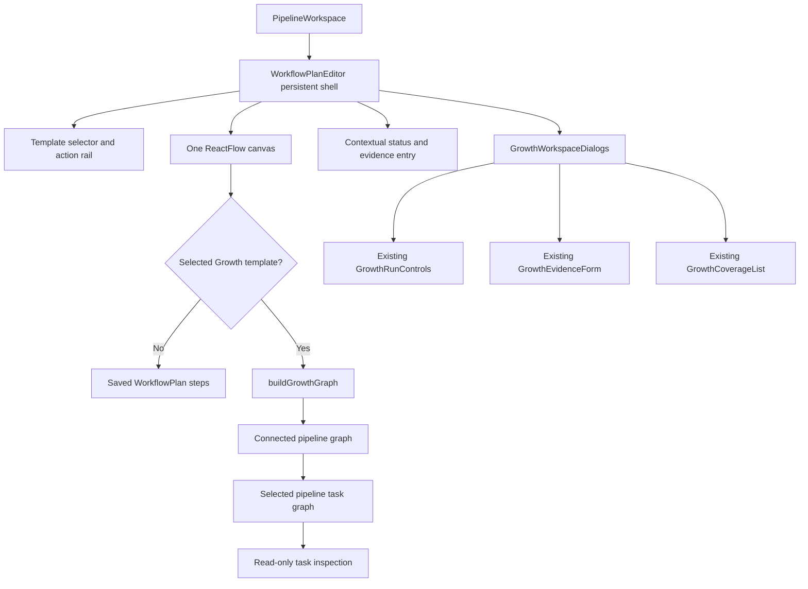
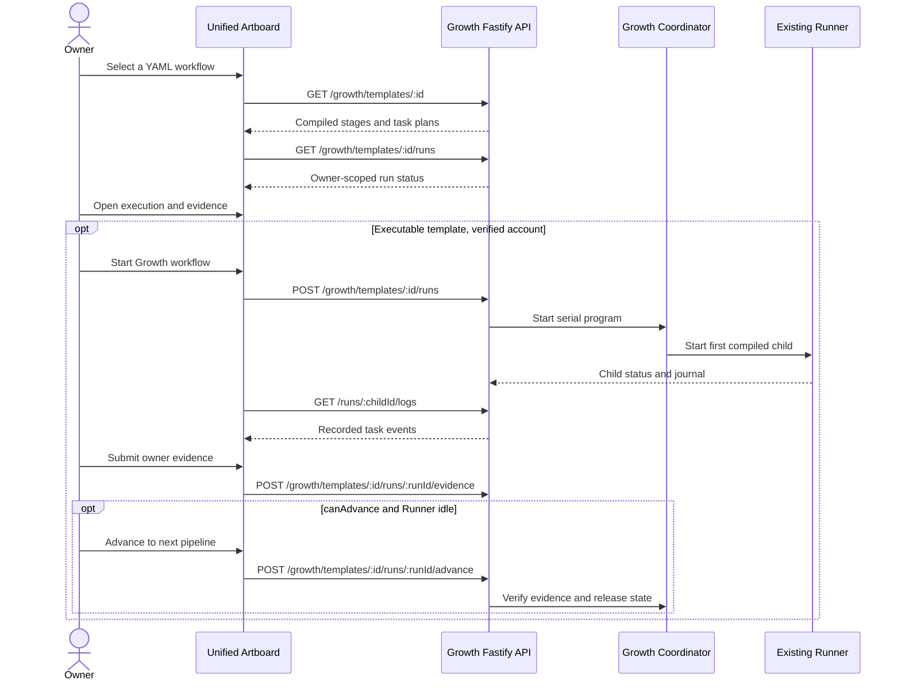

# Mator Artboard unification: stacked PR implementation ledger

> **Status: INVESTIGATED → PLANNED. Not implementation-complete.** This draft workstream branches from PR #15 (`d398f60ce59743e047fdf366b88e05b435117c2b`) and targets `work/mator-e2e-tracked-20261101`, **not** `main`. Preserve PR #15's Mator chat/voice changes. The source-backed prior investigation and five Mermaid diagrams are in [mator-unified-artboard-investigation.md](mator-unified-artboard-investigation.md).

## Verified baseline (2026-11-03)

- `apps/frontend/components/dashboard/pipeline/pipeline-workspace.tsx` hosts the current `WorkflowPlanEditor` and `FloatingWorkflowControls` inside the workspace pane. `app/dashboard/pipeline/page.tsx` redirects to the workspace.
- `workflow-plan-editor.tsx` currently replaces its normal `ReactFlow` canvas content with a `GrowthProfilePipelines` component whenever a Growth template is selected. That renders its own header, Growth controls, and nested `GrowthWorkflowArtboard` with another `ReactFlow`. The editor toolbar is already outside the conditional and should remain mounted.
- `growth-graph-model.ts` already converts compiled Growth stages and actual child `WorkflowPlan.links` into pipeline and task nodes. `use-growth-run-journal.ts` correlates task status with real child run logs. Reuse these models instead of creating a duplicate planner/renderer.
- `WorkflowPlan` is validated as a **serial** chain with typed earlier-step bindings. `workflow-registry.ts` persists revisioned validated JSON and `GET /workflows/:id/yaml` exposes the generated YAML representation. The Growth compiler reads **static** restricted YAML templates and currently allows task-title overrides only. Its read-only `GET /growth/templates/:id/yaml` is not an editable configuration persistence API.
- The Growth coordinator starts the **first** stage and advances serially after real child evidence and Runner cleanup; there is no independently selectable arbitrary pipeline execution route. `GrowthBlueprintWorkflow` is design-only and cannot execute.
- At the inherited PR #15 head, Actions checks include code-quality and integration failures. Do not attribute these failures to this stacked branch without comparison.

## Product interaction contract

Keep one persistent Artboard workspace and one visible graph canvas. The current workflow context chooses the graph projection, not a replacement editor. For a saved `WorkflowPlan`, node selection uses existing step-specific forms and revisioned save. For a selected Growth YAML program, show pipeline overview and an in-place pipeline task drill-down with breadcrumb back. Growth task information remains **read-only** until an owner-scoped, validated, revisioned source-YAML write contract exists. In all modes, show only real recorded run status and results.

Retain existing header/toolbar, selection, run forms, evidence links, account checks, chat state and approvals. Relocate secondary Growth coverage/requirements into a modal or compact secondary entry point rather than dropping records. Do not expose a pipeline Run action where the server cannot honor it. Keyboard-accessible task and pipeline navigation, responsive graph, empty and error states, and reduced-motion behavior are mandatory.

## Execution work packages and gates

| Slice | Owner | Scope | Acceptance proof |
| --- | --- | --- | --- |
| U1: One Artboard shell | UI/UX → Frontend | Replace the conditional standalone Growth screen with Growth graph content hosted by the same Artboard shell; reuse the current graph model and run-control consumers | Workspace toolbar remains identical across selection; keyboard drill-down/back; no duplicate Growth header/canvas, no lost run/evidence controls |
| U2: Context and selector | Frontend → Test | Explicitly distinguish saved executable workflows, compiled Growth programs and design-only blueprints; reset scoped selection and journals on switches | No state leaks, stale async responses or fabricated workflow availability; unchanged saved plan revisions |
| U3: Task configuration | API/Contract → Backend → Frontend | Use existing step-schema forms for saved plans; implement source-preserving, versioned Growth YAML editing **before** enabling Growth task editing | Invalid writes reject, success survives reload and YAML source round-trip, optimistic conflict handling; no arbitrary task rewrites |
| U4: Runtime semantics | API/Contract → Backend → Test | Preserve full workflow and serial coordinator; independently run a pipeline only with explicit dependency/account/evidence checks and run identity | Genuine Runner events and durable attribution; fail closed on missing upstream data |
| U5: UI polish | UI/UX → Frontend | Responsive layout, floating secondary tools, accessible dialogs, motion, artifacts | Playwright desktop/tablet/mobile + keyboard/axe + reduced motion; existing Mator chat unaffected |
| U6: Docs/review/release | Test → Reviewer → Dogfood → Git | Align five Mermaid docs to actual post-change system and validate API/UI/Runner | Tests, review, real runtime journey, branch SHA/diff, CI green or blockers documented |

### Immediate evidence-driven implementation sequence

1. Map the exact `WorkflowPlanEditor` component tree, Growth graph consumers, Next proxy allowlist, and frontend tests. Capture a reproducible regression for editor-shell replacement.
2. Implement U1 as a coherent, bounded patch, retaining existing working APIs and error paths. Do not restructure backend during a UI shell integration.
3. Run `pnpm --filter @utomator/frontend test`, `typecheck`, `lint`, `build`; focused Playwright interaction and responsive tests, then backend API/Runner regressions. CI does not replace executable local checks when a checkout is available.
4. After independent code review and Dogfood, land reviewed source in this **stacked draft PR**, update this ledger with exact SHA and test evidence; expand to U2-U5 after each dependency gate.

## Validation reality and blockers

This session can read and write the remote repository through GitHub, but `git ls-remote` from the executable container fails with `Could not resolve host: github.com`. Therefore a local full workspace checkout, dependency install, browser startup and Playwright run are not currently available. Documentation and planned work are not equivalent to production implementation. **Do not move this PR out of draft on the strength of planning alone.**

## U1 source integration candidate (2026-11-03)

**Status: SOURCE CANDIDATE, not locally validated, reviewed, or integration-verified.** The implementation change is scoped to frontend surface and regressions, with no new backend endpoints or permissions. The source is prepared to route the existing saved-plan graph and Growth YAML graph through a single React Flow canvas inside the existing editor shell. The separate Growth screen and nested Artboard are intentionally retired.

The compiled task inspector is **read-only**; task titles, kind, messages, typed input bindings, coverage, journal and source YAML may be inspected, but changes to Growth YAML are not persisted because the server does not expose a validated write endpoint. The same existing Growth coordinator handles starting a complete serial program, child approval/resume/cancel, evidence submission and allowed advance. No independent selected-pipeline launch is advertised.

The browser regression tests specifically assert one active graph, six connected profile pipelines, dependency edges, task drill-down and read-only details, a modal entry to real execution/evidence controls, and no Runner launch for design-only Growth YAML.

### Unified editor composition

Source: [diagrams/mator-unified-artboard-surface.mmd](diagrams/mator-unified-artboard-surface.mmd).

### Preserved execution and evidence boundary

Source: [diagrams/mator-unified-artboard-execution.mmd](diagrams/mator-unified-artboard-execution.mmd).

### Outstanding before review or merge

- Run TypeScript, Prettier, ESLint, frontend unit tests, backend browser integration tests and Playwright responsive/keyboard checks in a real checked-out workspace. The current sandbox has Node.js but cannot resolve/reach GitHub or acquire the pnpm checkout/dependencies.
- Independently review the compiled task selection behavior, focus return when a dialog closes, responsive graph viewport at phone/tablet widths, and status/evidence attribution.
- U2–U5 remain separate work packages; no source-preserving Growth YAML editing, arbitrary pipeline execution API, or provider-level profile updates are implied by U1.
