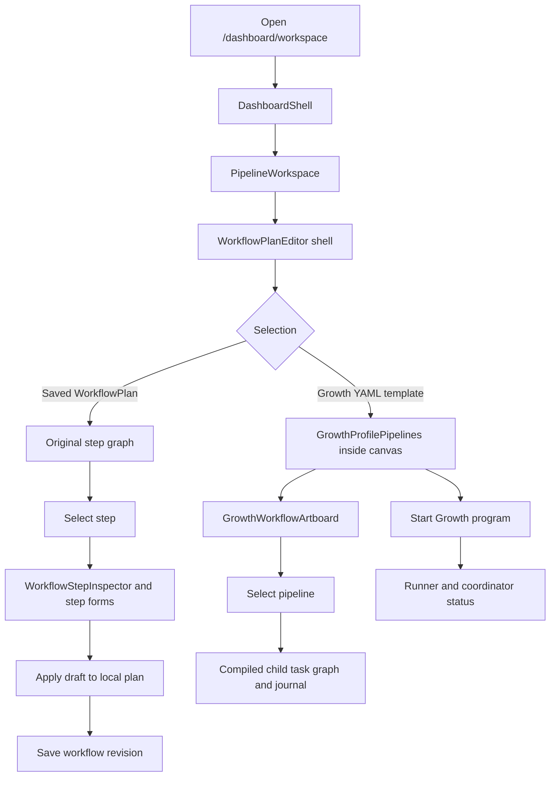
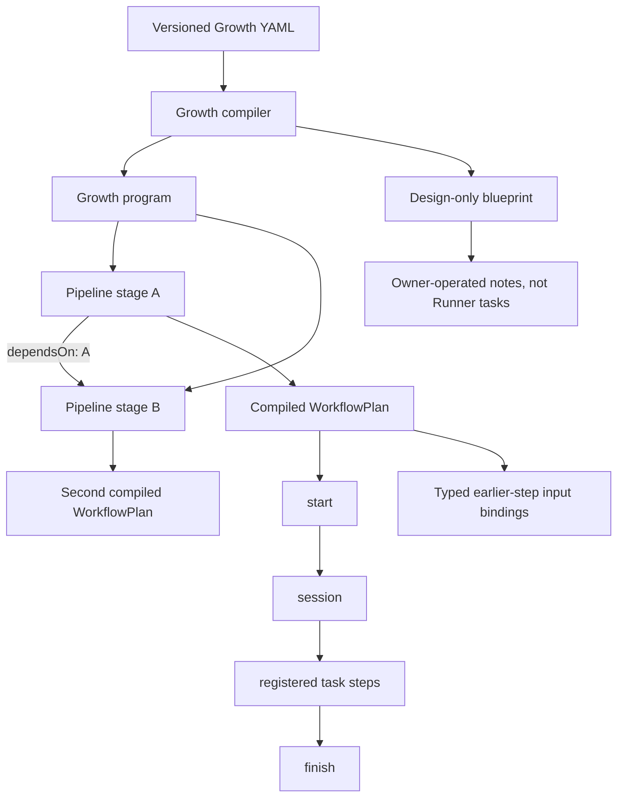
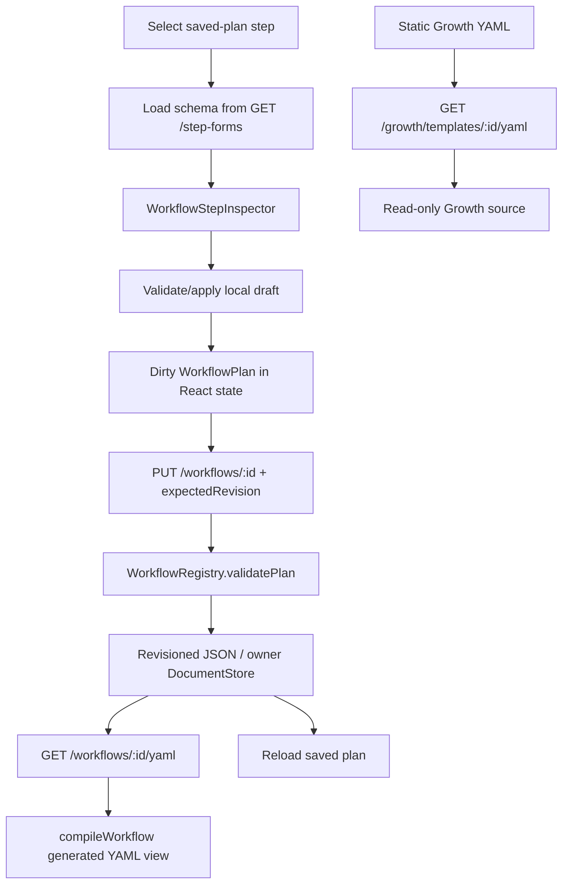
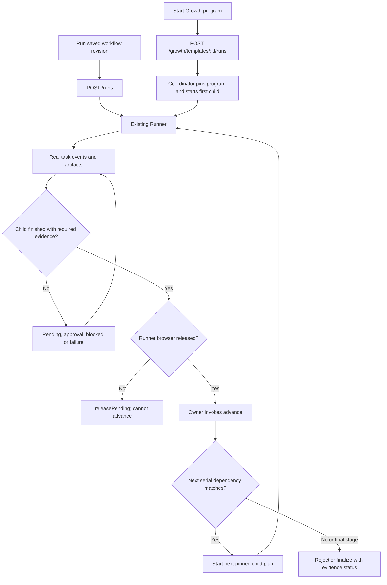
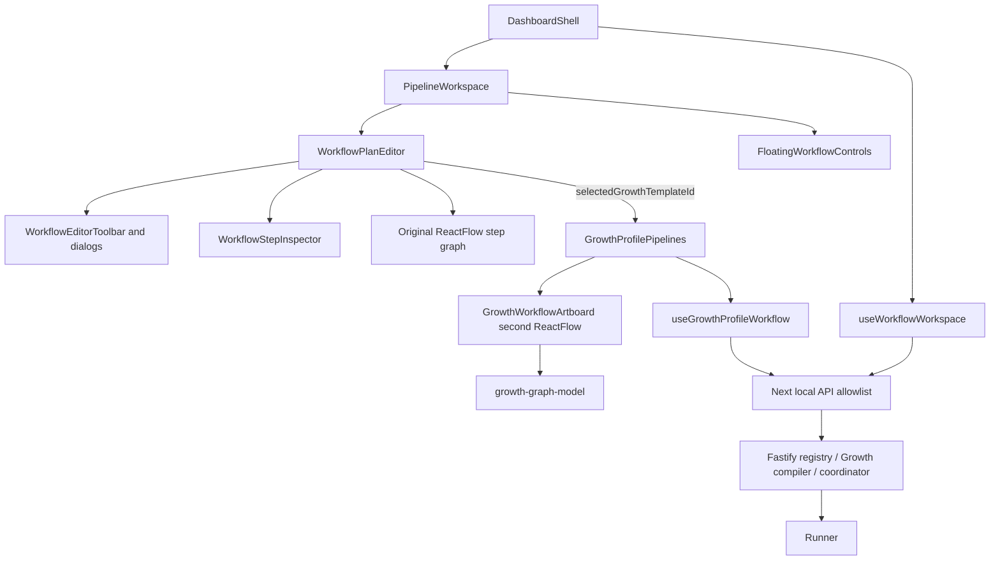

# Mator unified Artboard: verified architecture and implementation gates

> **Status: INVESTIGATED / PLANNED, not implemented.** Snapshot: PR #15 at `3598bae5c2aae2a46d073ece770c88540c2384a0`, inspected on 2026-11-03. The five diagrams below describe the **existing code**, including the separate Growth renderer. They must be revised after the actual unification. No browser execution, source modification, or YAML edit is implied by this document.

## Product decision and scope

The persistent Mator workspace should remain `/dashboard/workspace`, preserving `WorkflowPlanEditor`'s existing canvas, visual language, editing controls, and saved-workflow behavior. Growth provides a useful pipeline/task drill-down model and live child-Runner status, but its separate Artboard must not become a second workspace. Workflow selection should change the graph and selected context, **not** replace the editor shell.

Do not generalize a restricted serial Runner graph into a DAG, treat all Growth YAML as executable, or show an editable Growth task unless the validated definition can actually be persisted and recompiled. The supported execution boundary is the existing Runner, not a new engine.

## Verified source and consumer map

| Boundary | Existing source | Verified behavior |
| --- | --- | --- |
| Route and workspace | `app/dashboard/pipeline/page.tsx`, `dashboard/dashboard-shell.tsx`, `pipeline/pipeline-workspace.tsx` | Pipeline route redirects to workspace; shell selects the workspace pane and mounts a single `WorkflowPlanEditor` plus floating run controls |
| Original editor | `workflows/workflow-plan-editor.tsx`, `editor/workflow-editor-*.tsx`, `editor/workflow-step-inspector.tsx` | React Flow step graph, schema-driven step forms, local draft edits and saved plan revisions |
| Growth UI | `growth/growth-profile-pipelines.tsx`, `growth/growth-workflow-artboard.tsx`, `growth/growth-graph-model.ts` | Selecting a Growth template swaps the inner canvas for a second graph and control surface; pipeline drill-down and child-task journal already work for compiled plans |
| Selection and isolation | `pipeline/use-workflow-workspace.ts` | Saved workflow selection sets plan/action/form; Growth template ID is a separate state flag; saving a normal workflow uses `PUT /workflows/:id` |
| Restricted plan | `backend/src/core/workflow-plan.ts`, `backend/src/core/workflow-yaml.ts` | Typed step bindings, exactly one successor/predecessor, no branching/merging; YAML for a saved workflow is compiled from the persisted plan |
| Growth compiler | `backend/src/engine/growth-profile.ts`, `backend/growth/*-workflow.yaml` | Validates versioned YAML, compiles stages and pinned child plans; nonexecuting blueprints are explicitly design-only |
| Growth runtime | `backend/src/engine/profile-growth-coordinator.ts`, `backend/src/core/runner.ts` | Starts first child; later stage advances only after completed Runner evidence and released browser; no arbitrary independent-stage execution route |
| Persistence and API | `backend/src/core/workflow-registry.ts`, `backend/src/main.ts`, `frontend/app/api/[...path]/route.ts` | CAS revisioned `WorkflowPlan` JSON/DocumentStore; generated YAML endpoint; Growth YAML template GET endpoints are read-only |

`workflows/workflow-artboard.tsx` is another older graph component, but repository code search did **not** identify a live workspace import. Do not use it as a replacement merely because its filename contains “Artboard.”

## A. Existing user journey

The `E → K` branch is the verified UI discontinuity. The target change is to remove that *competing screen* without removing Growth's data, controls, or evidence.

## B. Existing workflow hierarchy and restricted dependencies

Stages currently form a serial dependency chain, and child `WorkflowPlan.links` are linear. A `StepInputBinding` can reference a validated prior **step** output; the current compiler does not establish general cross-pipeline output mappings or conditional parallel edges. Pipeline/task labels should not suggest otherwise.

## C. Existing configuration lifecycle

The generated saved-workflow YAML is not an editable Growth-template source. The Growth template endpoints do not presently implement write/merge/versioned YAML mutation. Do not claim round-trip editable Growth YAML until that contract and storage are implemented and tested.

## D. Existing execution lifecycle

`POST /growth/templates/:id/runs` starts the **program** and its first child, not any selected stage. `POST .../advance` progresses the serial program after proof. The child Runner's own cancel/resume/decision endpoints are separate; there is no general independently selectable pipeline-start API here.

## E. Existing frontend component architecture

This double graph ownership is why the UI must be consolidated in one canvas shell. Mator chat and voice are separate consumers of workflow and run context; preserve them during navigation and state changes.

## Implementation handoff: bounded work packages

1. **Unified shell and context.** Remove the Growth-versus-standard conditional *screen replacement* in `WorkflowPlanEditor`. Model current selection explicitly as a saved executable plan or a compiled Growth program, with stable IDs and appropriate per-workflow run context. Keep editor toolbar, canvas controls, and overall workspace mounted during switching. Test switching during loading, after a failed fetch, with unsaved changes, and across chat threads.
2. **Shared graph surface.** Reuse the existing Growth graph-model derivation for pipeline overview and child task drill-down, but render through the original canvas/toolbar system, with a breadcrumb and consistent node states. Design-only blueprint tasks remain visibly nonexecutable and noneditable unless a matching persistence contract exists. No arbitrary graph connections.
3. **Contextual task forms.** Reuse `/step-forms` and `WorkflowStepInspector` for editable saved `WorkflowPlan` tasks. Separate task-specific requirements, coverage, evidence and runtime details in appropriate dialogs/overlays. Never apply a local change to a Growth task and call it saved while the YAML source remains unchanged.
4. **Growth YAML persistence contract.** Before enabling Growth task editing, add owner-scoped versioned definition storage through the existing DocumentStore/CAS infrastructure, preserve original YAML and identifiers, validate and recompile on write, pin versions to running programs, and add narrow API + Next proxy allowlist entries. Decide how YAML external edits and UI reload reconcile. Keep design-only execution limits and avoid a second engine. Update `growth-workflow-implementation-handoff.md` and both persistence consumers.
5. **Runtime controls.** Keep the working full-workflow and serial Growth coordinator actions. Introduce independently runnable pipeline controls **only** after a server contract validates account ownership, required inputs, dependency/evidence provenance and immutable run attribution. Otherwise present an explicit unsupported state, not a fake Run button.
6. **Visual quality and testing.** Move secondary controls to the existing floating toolbar; preserve approvals, evidence and run history. Improve focus restoration, keyboard operation, touch targets, mobile drill-down, reduced-motion transitions and error states. Run the existing Node/TypeScript/build suites, responsive Playwright and real Runner tests; independent review/dogfood precede release.

## Acceptance and validation gates

- A single Artboard stays mounted while selected content changes. Workflow, pipeline and task IDs scope configurations, chat threads and journals independently.
- Pipeline relationships render only compiled dependencies. Unsupported blueprints cannot execute; no fabricated output or task status.
- A saved `WorkflowPlan` task edit uses server-side validation and `expectedRevision`, survives reload and appears in its generated YAML output.
- Growth task edits must additionally persist the **source** definition and recompile from it, with revision conflicts, unknown fields, invalid references and failed dependencies rejected, before the edit affordance is enabled.
- A program run and an independently authorized pipeline run must have distinguishable persisted identities and evidence.
- Regressions: default audit remains functional; previous saved plan revisions, old Growth library pages, approvals, annotated evidence, command paths, Mator chat/voice and Runner isolation remain intact.
- Tests: `pnpm test:frontend`, `pnpm test:backend`, frontend/backend typecheck and builds, frontend format/lint, backend Biome, Playwright interaction/responsive tests, runner integration and real credentialed dogfood when available.

### Current blockers

The inspected PR head has failing `Utomator code quality` and `Utomator integration` Actions (plus failing React Doctor status). The executable container cannot resolve `github.com` for a local checkout; there is no installed/runnable app available to conduct the required tests here. **No production implementation, test pass, review approval, or complete state is claimed for this Artboard workstream.** Keep PR #15 in draft.
