# Utomator: Unified Growth, Workflow, Graph and Pipeline Architecture

> **Status:** Proposed architecture — not implemented.  
> **Repository:** `surdma/utomator`. **PR:** [#6 — Unified LinkedIn Growth Workspace](https://github.com/surdma/utomator/pull/6).  
> **Date:** 28 October 2026. **Scope:** Growth, Craft, canonical graphs, pipeline releases, execution, persistence and migration.

This proposal documents the separation currently present in Utomator and a migration toward **one logical, modular execution engine**. PR #6 consolidates the Growth catalogue and MDX visual authoring; it does **not** implement the engine design below.

  <strong>UTOMATOR · UNIFIED WORKFLOW ARCHITECTURE</strong> 
  One canonical graph · One execution engine · Specialized capability modules

<table>
<tr><td align="center"><strong>GROWTH</strong> Goals and outcomes</td><td align="center"><strong>CRAFT</strong> Reusable procedures</td><td align="center"><strong>GRAPH</strong> Typed dependencies</td></tr>
<tr><td align="center"><strong>PIPELINE</strong> Validated release</td><td align="center"><strong>ENGINE</strong> Authorized execution</td><td align="center"><strong>RESULTS</strong> Evidence and feedback</td></tr>
</table>

> [!IMPORTANT]
> **Target design, not implemented functionality.** The visual diagrams illustrate the recommended future architecture. Today, Craft and WorkflowPlan are separate, and PR #6 does not introduce a unified engine.

This is one GitHub-renderable Markdown file. The visual diagrams use GitHub's native Mermaid rendering, and the introductory cards use supported inline HTML. There is no separate HTML page, external script or duplicated document.

## 1. The central architectural problem

Utomator has an execution engine, but Growth, Craft and Pipeline **do not yet share an executable workflow definition**.

| Area | Current responsibility | Engine connection |
| --- | --- | --- |
| Growth | 15 LinkedIn capabilities, goals, 107 proposed actions and availability | Mostly descriptive product definitions |
| Craft / Growth MDX | Reusable instructions and visual graphs | Cannot directly compile into the Runner |
| Pipeline | Action-specific, validated WorkflowPlans | Connected to the Runner |
| Workflow Runner | Supported browser operations, approval gates, events and output | Operational, bounded by registered actions |
| Research and Editorial | Specialized research, drafts, approval and publishing services | Separate lifecycles, not generally graph-orchestrated |

### Present-day separation

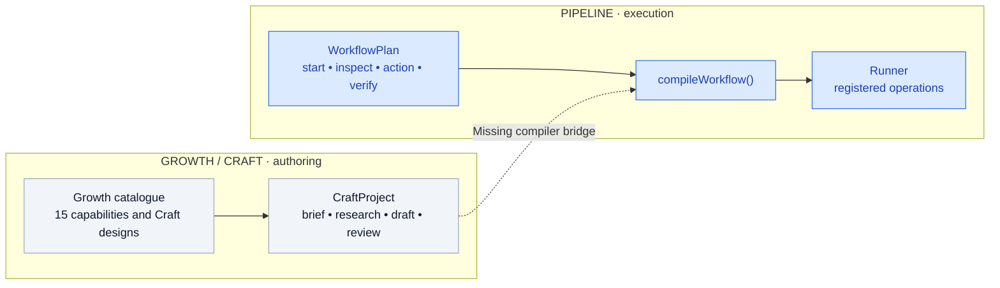

The dashed link is an **unimplemented connection**, not a functioning integration.

There are **two graph contracts**:

- **Craft:** `CraftProject`, `CraftStep`, `CraftLink`, with node kinds `brief`, `research`, `draft`, `review`, `publish`, `measure`. See `apps/backend/src/crafts/library.ts`.
- **Execution:** `WorkflowPlan`, `WorkflowStep`, `WorkflowLink`, with kinds `start`, `session`, `inspect`, `action`, `verify`, `note`, `delay`, `assess`, `evidence`, `approve`, `pause`, `stop`, `finish`. See `apps/backend/src/core/workflow-plan.ts`.

The present `compileWorkflow()` accepts a `WorkflowPlan`, **not Craft MDX**. It validates action-specific linear plans (4–24 steps); the `Runner` executes compiled registered operations. A Growth visual workflow therefore cannot simply be run as a pipeline.

**Gap:** Unified presentation is not unified authoring, compilation, orchestration or outcome tracking.

## 2. The architecture Utomator should have

Create **one modular workflow platform**, with different product domains using shared contracts.

- **Growth** determines *why*: goal, audience, strategy, baseline, KPIs and target outcome.
- **Craft** defines *how*: reusable expert process instructions and evidence requirements.
- **Graph** describes *what*: typed nodes, connections, data dependencies, decisions and conditions.
- **Pipeline** is the validated, immutable version of that graph, bound to inputs, account, policy and handler versions.
- **Engine** determines *whether and how*: validates authority, schedules, dispatches, checkpoints and records evidence.
- **Run and Outcome** capture *what happened* and *what can be verified*.

### The six complementary concepts

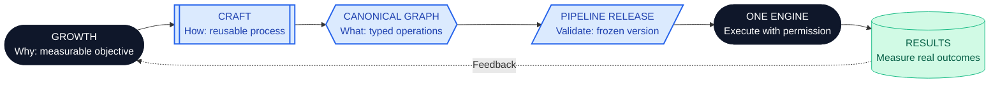

**Invariant:** One authoritative workflow execution definition. Visual, MDX and pipeline views cannot maintain competing business-logic copies.

## 3. Proposed system architecture

**TARGET ARCHITECTURE — NOT YET IMPLEMENTED**

<strong>Target architecture · Shared authoring, centralized orchestration, specialized adapters</strong>

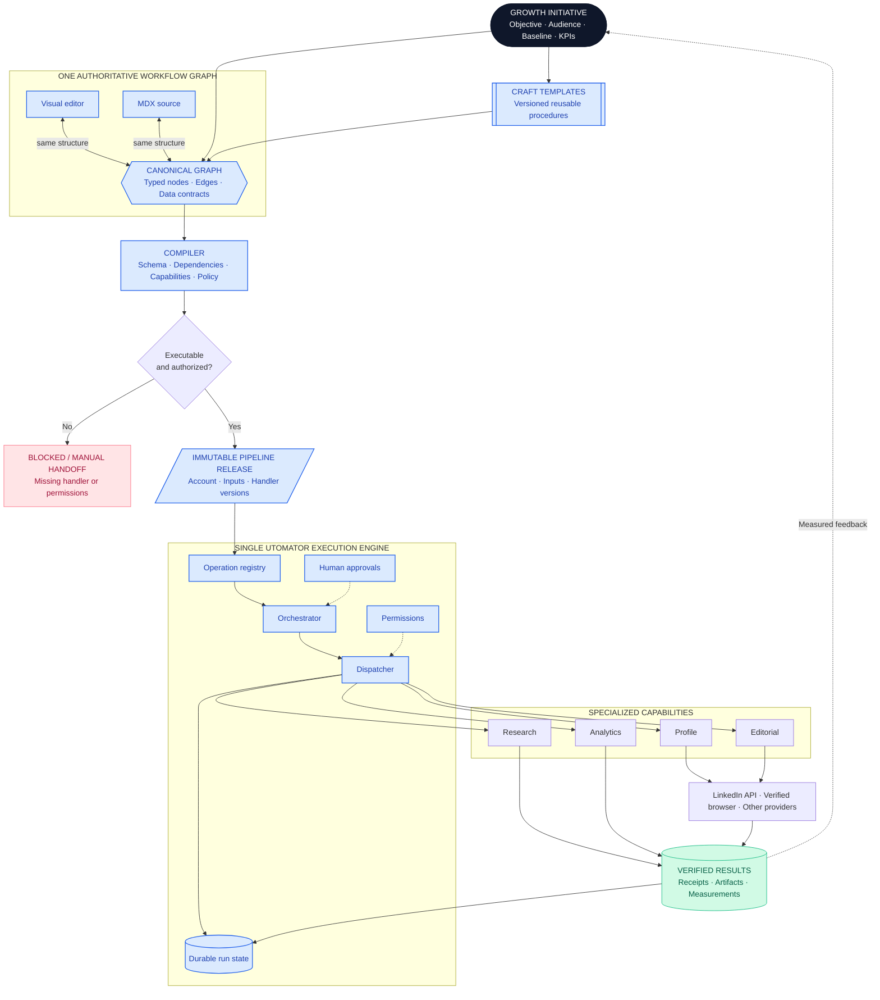

**Solid lines** show proposed execution and data dependencies. **Dotted lines** show supporting rules or feedback. This is a **target-state diagram**, not proof that these routes exist.

The graph describes the operation and its dependencies; the engine enforces permission, execution method and truthful results.

Changing a node's visual position must never alter business logic. An MDX instruction must never grant permission to run arbitrary JavaScript, invoke unregistered operations or bypass social-provider safeguards.

## 4. How Growth, Craft, Graph and Pipeline relate

| Concept | Purpose | Example |
| --- | --- | --- |
| Growth initiative | Long-term objective with KPIs and milestones | Improve visibility to generate relevant interviews |
| Craft definition | Reusable specialized process | Evidence-backed headline optimization |
| Workflow graph | Typed nodes and dependencies | Inspect → evaluate → propose → approve → verify |
| Pipeline | Executable version bound to account and authorized inputs | Profile optimization release v2 |
| Run | One execution attempt | Profile audit on 28 October 2026 |
| Outcome | Evidenced result with attribution limits | Approved changes; documented recruiter enquiry |

One Growth initiative can coordinate many workflows, and one workflow can reuse several Craft definitions. A job-seeking initiative might link career research, profile audit, tailored applications, content and opportunity measurement without rebuilding each feature's data.

### One Growth initiative, several reusable workflows

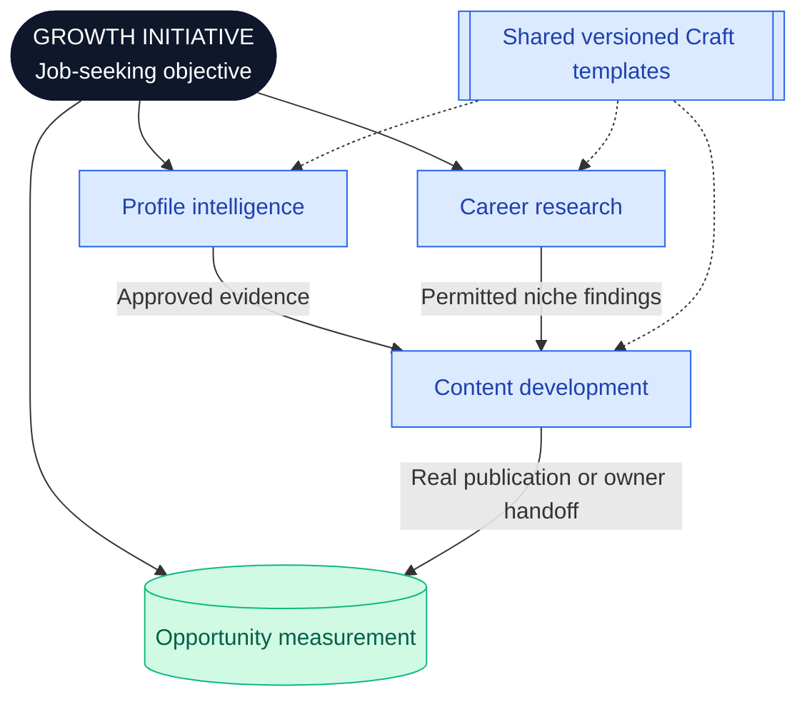

**A graph is not a pipeline merely because it is rendered.** Only validated graphs with real registered handlers and satisfied permissions are executable.

## 5. One canonical workflow definition

Replace competing authoring models incrementally with a canonical typed **intermediate representation (IR)**. The following TypeScript is **proposed, not currently implemented**.

~~~typescript
interface WorkflowDefinition {
  id: string;
  version: number;
  identity: {
    name: string;
    description: string;
    growthCapabilityId?: string;
    platform: "linkedin" | "x";
  };
  objective: {
    goal: string;
    audience: string;
    successMetrics: string[];
  };
  graph: {
    nodes: WorkflowNode[];
    edges: WorkflowEdge[];
  };
  lifecycle: "draft" | "ready" | "archived";
}

interface WorkflowNode {
  id: string;
  operation: string;
  operationVersion: number;
  inputs: Record<string, unknown>;
  outputSchema: string;
  executionMode: "internal" | "official-api" | "browser" | "human";
  instructions?: string;
  position?: { x: number; y: number };
}

interface WorkflowEdge {
  source: string;
  target: string;
  condition?: string;
}
~~~

The **visual editor** edits canonical nodes, edges and layout. The **MDX editor** expresses permitted metadata and readable instructions. The **compiler** resolves typed dependencies, validates cycles/conditions and checks the registry. The **engine** accepts only a compiled, authorized pipeline release.

### A real executable graph needs typed decisions and handoffs

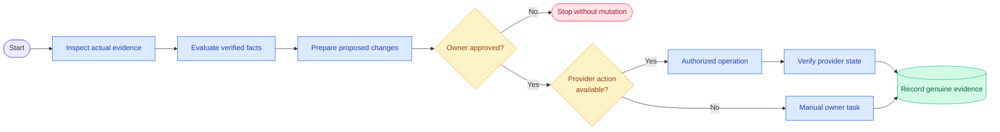

These nodes and handlers are **proposed**. A visual stage named `publish` is not an authorization to publish.

The existing `compileWorkflow()` is a useful starting point but its linear, action-specific limitations must evolve with compatibility tests. Before implementing the IR, specify schema identifiers, stable serialization, branching, handler versions, account scopes and typed output references. `position` is presentation-only.

## 6. One operation registry, many specialized capabilities

The engine owns orchestration; modules own domain logic. All capabilities implement a shared registered handler contract.

| Proposed operation | Owner | Expected behavior |
| --- | --- | --- |
| `linkedin.profile.inspect` | Profile adapter | Read permitted account evidence |
| `linkedin.profile.evaluate` | Profile intelligence | Analyze supported profile sections |
| `research.creator.compare` | Research | Compare supplied, permitted evidence |
| `editorial.post.draft` | Editorial | Persist a structured draft |
| `editorial.post.publish` | Publishing | Publish with actual OAuth rights and approved content |
| `approval.request` | Core engine | Create a durable human approval checkpoint |
| `opportunity.record` | Opportunities | Record a documented outcome |
| `analytics.baseline.compare` | Analytics | Compare real measurements |

**All identifiers in this table are illustrative.** Do not advertise them as runnable until their schemas, handlers, authorization policies, failure behavior and tests exist.

~~~typescript
interface OperationHandler<Input, Output> {
  operation: string;
  version: number;
  validate(input: unknown): Input;
  checkAvailability(
    context: ExecutionContext
  ): Promise<CapabilityAvailability>;
  execute(
    input: Input,
    context: ExecutionContext
  ): Promise<Output>;
}
~~~

### Shared dispatcher and independently owned handlers

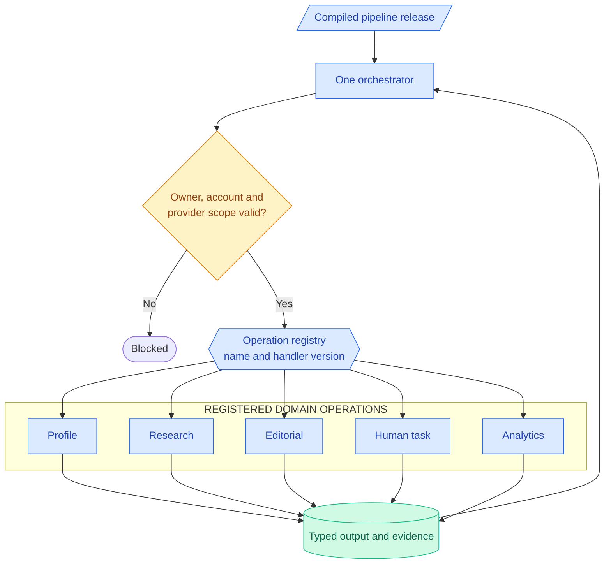

For every handler, register input/output schemas, external mutation status, owner/tenant/account authorization, required provider permissions, evidence, audit requirements, idempotency and retry policy. Browser handlers must verify the connected owner session; research must preserve provenance; publishing must retain OAuth and provider checks. A human task waits for an actual human decision.

## 7. Complete lifecycle of a Growth workflow

1. **Define initiative.** Select account, professional goal, audience, baseline, milestones and metrics.
2. **Compose workflow.** Connect relevant versioned Craft procedures with typed dependencies.
3. **Validate and compile.** Check schema, graph, operations, account scope, credentials, authorization and evidence requirements. Unsupported steps remain non-executable.
4. **Release pipeline.** Snapshot the compiled definition, referenced versions and approved configuration.
5. **Execute.** Orchestrate eligible nodes, dispatch operations, persist outputs, wait for approvals and retry only when safe.
6. **Verify.** Record real provider receipts, observations, human decisions, artifacts, errors and limitations.
7. **Measure and iterate.** Compare with Growth baseline, then propose a new version without silently altering approved runs.

### Seven-stage end-to-end flow

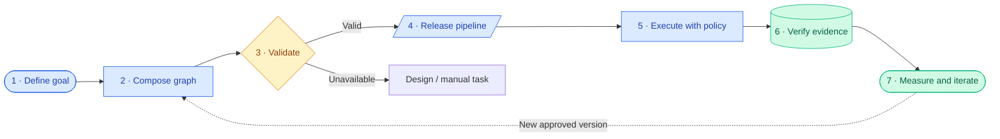

The result is a feedback loop with auditable outcomes, not disconnected task cards.

## 8. Example: LinkedIn professional presence growth

**Objective:** Increase evidence-based professional visibility and qualified opportunities.

<strong>Professional visibility · An orchestrated Growth program</strong>

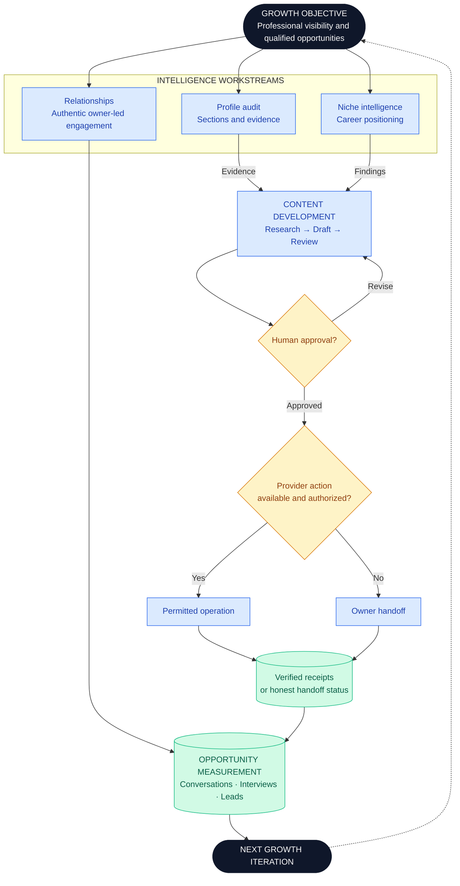

All workflows share a Growth initiative ID, authorized account context and typed evidence references. Content can consume approved findings from Profile Intelligence, avoiding duplicated inputs and manual copying.

A successful research step is not proof of publication. If a provider operation is unavailable, the run must become **blocked** or **awaiting owner action** rather than invent a receipt.

## 9. What the execution engine must own

| Component | Responsibility |
| --- | --- |
| Definition Registry | Workflow versions and reusable operation references |
| Graph Compiler | Type checks, graph validation and dependency ordering |
| Orchestrator | Determines eligible nodes and graph progression |
| Dispatcher | Calls registered handlers |
| Execution State | Durable runs, attempts, status and checkpoints |
| Human Task Manager | Approvals, inputs and manual-action confirmations |
| Scheduler | Delayed, recurring and resumable executions |
| Policy Engine | Owner, tenant, account, credentials and provider rules |
| Evidence Store | Sources, drafts, receipts and artifacts with provenance |
| Outcome Tracker | Baseline, measurements and attribution limits |

The present `Runner` already supports browser-centric compilation, outputs, human approval, pause/resume, journals and archived summaries. It permits **one active browser workflow** and is not yet a shared orchestrator for Research, Editorial and Growth. Preserve working behavior and introduce adapters rather than replacing it wholesale.

### Durability, retries and uncertainty

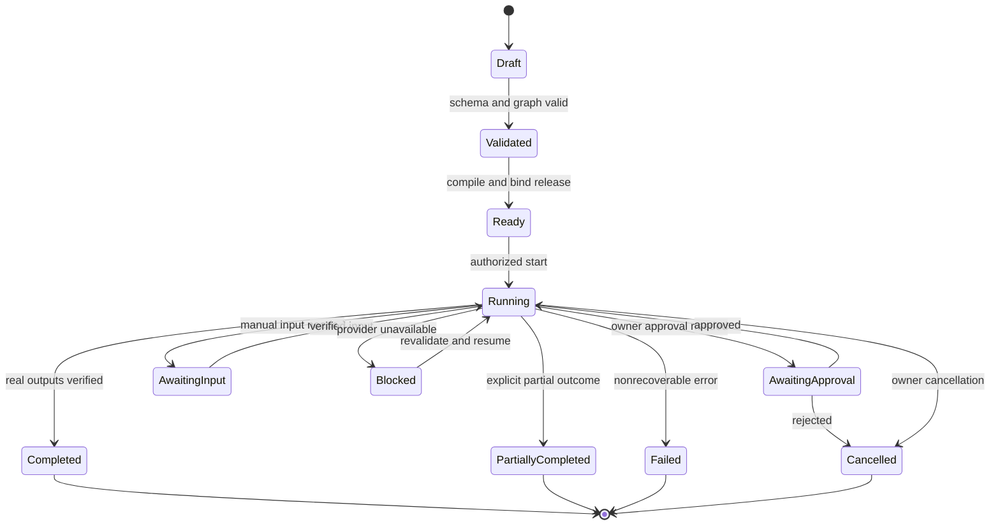

A long-running Growth program must survive restarts and delayed approval. Persist transitions, node attempts and output references. External mutations require idempotency when possible, reconciliation of uncertain provider outcomes and genuine evidence before marking a node completed. Avoid replaying a published post or profile edit simply because a client timed out.

## 10. Persistence and source-of-truth architecture

Utomator already has a tenant-scoped `DocumentStore` supporting local SQLite and configured PostgreSQL. It can support versioned definitions initially. Concurrent, durable orchestration requires further transactional and recovery design.

| Proposed entity | Associations |
| --- | --- |
| `growth_initiative` | Owner, account, strategy, KPI and baseline |
| `workflow_definition` | Canonical graph and version |
| `workflow_template` | Craft/capability instructions and version |
| `initiative_workflow` | Dependencies between an initiative's workflows |
| `pipeline_release` | Immutable compiled configuration |
| `workflow_run` | Actor, account, state and lifecycle |
| `step_attempt` | Versioned handler, inputs, outputs, errors and times |
| `approval_checkpoint` | Real owner decision, evidence and timestamp |
| `artifact` | Generated output and provenance |
| `opportunity` | Verified outcome and defensible attribution |

### Proposed entity relationships

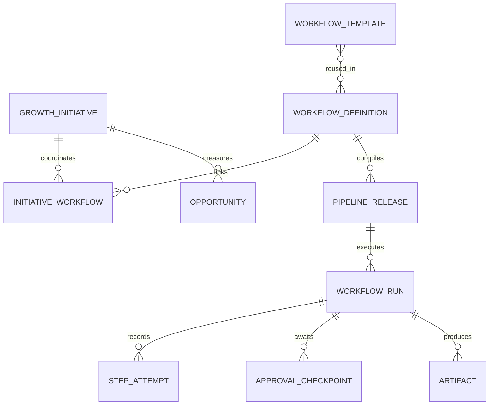

This entity diagram is a **proposed logical schema**; it does not assert that these database tables already exist.

These are **proposed logical entities**, not a claim that all tables exist. PostgreSQL is a reasonable hosted transactional source of truth. Add Redis only after a real queue, cache or coordination need is established; it must not become a competing state authority.

## 11. Proposed code ownership

This is a responsibility map, **not** a request to create empty folders.

~~~text
apps/backend/src/
├── engine/
│   ├── contracts/
│   ├── registry/
│   ├── compiler/
│   ├── orchestrator/
│   ├── dispatcher/
│   ├── lifecycle/
│   ├── scheduler/
│   ├── policy/
│   ├── evidence/
│   └── persistence/
├── modules/
│   ├── growth/
│   ├── profile/
│   ├── research/
│   ├── editorial/
│   ├── relationships/
│   ├── opportunities/
│   └── analytics/
├── integrations/
│   ├── linkedin/
│   ├── browser/
│   └── social/
└── api/
    ├── growth/
    ├── workflows/
    ├── runs/
    └── accounts/
~~~

The frontend should offer one coherent Growth experience: catalogue, objectives, graph design, MDX source, pipeline configuration, history and outcomes. Research and Editorial may retain focused screens while using shared execution contracts.

**Consolidate contracts and orchestration, not all business logic into one enormous service.**

## 12. Incremental migration plan

| Phase | Change | Completion criterion |
| --- | --- | --- |
| 1. Canonical contracts | Typed IR, versioning and operation registry | Growth and Pipeline can represent one workflow definition |
| 2. Unified authoring | Visual/MDX/workflow editor adapters | One version round-trips across all representations |
| 3. Execution adapters | Wrap Runner, Research and Editorial | Supported operations use one dispatcher, safeguards retained |
| 4. Durable lifecycle | Runs, checkpoints, attempts, approvals and recovery | Genuine records, restart/resume and safe retry behavior |
| 5. Growth initiatives | Shared objective, account and workflow dependencies | One initiative coordinates multiple pipelines |
| 6. Feedback loop | Baselines, tracked outcomes and evaluation | Verified progress is visible, not just action counts |

### Migration roadmap

Phases are **proposed work**, not current completion claims.

**Preservation rule:** Never remove a working specialized service before its behavior is reproduced and tested behind the engine. Retain Research evidence handling, Editorial approvals, publishing authorization, browser ownership checks, tenant isolation and revision semantics.

**Acceptance/validation for a future implementation:**

- Graph cycles, unknown handlers, typed bindings, conditional branches and schema versions are validated.
- Visual ↔ MDX ↔ canonical IR round-trips without untrusted source executing code.
- Tenant, account, credentials and approval checks happen before mutations.
- Delayed approval, restart/recovery, failure, cancellation, idempotency and uncertain outcomes work.
- End-to-end profile research → draft → approval → permitted action/human handoff → genuine artifact → measured result is demonstrated.
- Existing Pipeline workflows, personal Craft clones, 15 capabilities, six original templates, Research and Editorial behavior remain intact.

## 13. What this means for PR #6

PR #6 brings the **15 Growth capabilities and six original Craft designs** into one catalogue/authoring experience, making 21 reusable MDX/visual templates available. The designs are useful source material for canonical workflows; their instructions and proposed actions are **not executable integrations**.

Engine integration should be a **separate implementation change** focused on the actual compiler, operation registry, Runner, Craft persistence contracts, Research and Editorial adapters. It needs its own specification, migration plan, contract tests, review and end-to-end validation.

For this PR, keep the boundary explicit: **catalogue, authoring and architecture documentation; not a production engine rewrite.**

## Final architectural decision

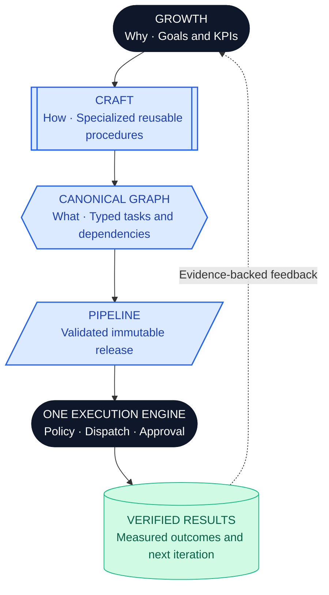

Make the unified workflow engine Utomator's core product architecture and Growth its first major application domain. LinkedIn is a capability provider, **not the engine**. That creates room for further social accounts, research, career workflows and opportunities without disconnected execution systems.

---

### Current-repository source anchors

- `apps/backend/src/crafts/library.ts` — Craft graphs, MDX source and library.
- `apps/backend/src/core/workflow-plan.ts` — existing executable WorkflowPlan contract.
- `apps/backend/src/core/workflow-yaml.ts` — `compileWorkflow()` and compiled step documents.
- `apps/backend/src/core/runner.ts` — execution, browser controls, approvals and archives.
- `apps/backend/src/main.ts` — service registrations and API surfaces.
- `apps/frontend/components/automate/pipeline.tsx` — Pipeline authoring and run submission.
- `docs/plans/growth-unification-spec.md` and `docs/plans/growth-unification-implementation-plan.md` — existing PR #6 scope and release criteria.

**Current status: INVESTIGATED / ARCHITECTURE PROPOSED.** This document makes no claim that the canonical IR, central dispatcher, shared run lifecycle, scheduling, or outcome tracking are implemented.

## Documentation and reusable diagram assets

- [Expert-methodology knowledge reference](../knowledge/growth-craft-methodology.md) explains sourcing, context-fit, account-specific inputs, honest approvals, evidence and outcome measurement.
- [Mermaid and SVG diagram library](./diagrams/README.md) preserves all twelve diagrams above as standalone editable Mermaid files alongside two new method/journey diagrams and five portable SVG companions.
- [Documentation index](../README.md) links the product decisions, implementation plans, knowledge and vector assets.

Mermaid fences in this document are GitHub-rendered vector visuals. Separate SVGs are simplified portable illustrations; consult the Mermaid source for complete graph semantics.
