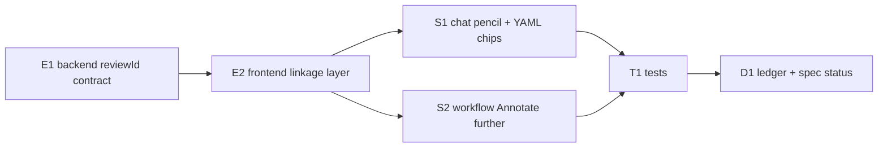

# Implementation Plan: Restore the YAML-driven annotation modal

**Spec:** `docs/superpowers/specs/2026-11-01-annotation-modal-restore-design.md`
**Branch:** `work/mator-e2e-tracked-20261101`
**Date:** 2026-11-01
**Status:** IMPLEMENTED — local Node evidence recorded in `.superpowers/sdd/annotation-modal-restore-progress.md` and `docs/architecture/mator-end-to-end-implementation-handoff.md`. Review and live dogfood are still open.

Ordering follows the dependency graph: backend contract first (E1), then the
frontend linkage layer (E2), then the two UI surfaces (S1, S2), then tests and
the documentation ledger (T1, D1). Each phase lists exact files and the
verification gate that closes it.

---

## Phase E1 — Backend: review-linkable chat assets (enabler)

**Goal:** an operator-created review (`annotation YAML`) can be referenced from
a chat asset metadata record.

### E1.1 `apps/backend/src/core/mator-attachments.ts`

- Add `reviewId?: string` to `MatorAttachmentMeta`.
- Export constant `MATOR_REVIEW_ID_PATTERN = /^[a-f0-9-]{36}$/i` (same shape as
  `uuid` in `visual-review.ts:87`).
- Extend `upsertMarkers(docs, attachmentId, markers, reviewId?)`:
  - when `reviewId` is provided, it must match the pattern, else
    `throw Error('Invalid review reference')`;
  - store it on the returned meta (`reviewId` cleared only by omission —
    PATCH is total: the frontend always sends current markers; `reviewId` set
    only when provided).
- Update all callers (type change ripples to `mator-actions.ts`).

### E1.2 `apps/backend/src/core/mator-actions.ts`

- `MatorAction` variant `annotate_image` gains optional `reviewId`.
- `parseMatorAction` (case `annotate_image`, line ~293): validate with the same
  pattern; unknown/bad shape → `MatorActionValidationError('Invalid action.reviewId', 'action.reviewId')`.
- `applyAction` (line ~576): `upsertMarkers(docs, input.action.attachmentId, input.action.markers, input.action.reviewId)`.

### E1.3 `apps/backend/src/core/mator-routes.ts`

- `PATCH /mator/attachments/:id/markers` body gains `reviewId?: string`:
  validate pattern → 400 `Non-empty 'markers' array required`-style error for
  bad review refs (`'Invalid review reference'`); pass through to
  `upsertMarkers`.
- `MatorRouteDeps` gains optional
  `resolveVisualReview?: (id: string) => Promise<unknown>`; when a `reviewId`
  is provided and the resolver misses, respond **400** with
  `'Review does not exist'` (no fabricated link — evidence honesty).
- `withAttachmentDetails` (line ~52) and the caps-respecting meta projections
  include `reviewId: meta.reviewId` so galleries render the YAML link after
  reload.

### E1.4 `apps/backend/src/main.ts`

- At `registerMatorRoutes(app, {...})` (line 239) the `visual` store exists
  (created line 95): pass
  `resolveVisualReview: (id) => visual.yamlFor(id).then(Boolean)` (cheap and
  exact — YAML only exists for annotation-carrying reviews).

**Gate:** `pnpm --filter @utomator/backend typecheck && pnpm test:backend`.

---

## Phase E2 — Frontend API + linkage layer (enabler)

**Goal:** the shell's single `VisualReviewPanel` can be opened for chat
images and the created review linked back to the asset.

### E2.1 `apps/frontend/components/dashboard/pipeline/mator-api.ts`

- `MatorAttachmentMetaDto` gains `reviewId?: string | null`.
- `patchMatorMarkers(attachmentId, markers, reviewId?)` — include `reviewId`
  in the PATCH body only when provided.

### E2.2 `chat events` types (`mator-chat-state.ts`)

- `MatorChatEvent.attachments[i]` and top-level asset rows gain
  `reviewId?: string`.

### E2.3 `use-mator-chat.ts`

- `saveMarkers(attachmentId, markers, reviewId?)` forwards the ref and merges
  the returned meta (markers + reviewId) into affected events (both the
  `attachments[]` rows and the single `attachmentId` shape).
- Remove the duplicated `throw err;` (line ~361).
- No change to send/upload flow; composer still calls `saveMarkers` on send.

### E2.4 `use-visual-reviews.ts` + `visual-review-panel.tsx` types

- `ImageSource` `upload` variant gains optional `chatAssetId?: string`.
- `saveVisualReview` strips `chatAssetId` before POST, then — when present —
  calls a new injected option `linkAssetReview(attachmentId, reviewId)`;
  failure sets `imageError` to
  `'Saved as review <id> but could not link to the chat message. Re-open the annotation editor to retry.'`
  (visible warning; never fabricated as success).
- New option `annotateChatImage?: (request: {
    file?: File; attachmentId?: string; })}
    => Promise<{ reviewId: string }>`
  implemented in `dashboard-shell.tsx`:
  1. guard: `selectedPage` must be non-empty (else `throw Error('Open a pipeline account page before annotating chat images as YAML reviews')`);
  2. build `imageData` — pending asset: read `file` via `FileReader` (reuse
     `validateReviewImage` rules, 8 MB cap); sent attachment: `fetch`
     `matorAttachmentFileUrl(id)` → blob → data URL;
  3. `setImageDraft({ kind: 'upload', src: dataUrl, imageData, chatAssetId })`
     and return a promise resolved by the existing save flow with the review
     id (extend `onReviewSaved` plumbing: saveVisualReview resolves the
     pending promise when `annotateChatImage` opened the draft);
  4. on close without save → resolve `null` (caller keeps pins as-is).

**Gate:** `pnpm --filter @utomator/frontend typecheck`.

---

## Phase S1 — Chat image surface: pencil entry, YAML chips, fallback

### S1.1 `mator-attachment-preview.tsx`

- New optional prop `onAnnotateFull?: () => void`; when present the thumbnail
  gains a pencil button (`data-testid="mator-annotation-full-pencil"`,
  ≥44×44 target, aria-label `Annotate as saved review`). Missing glue →
  current behavior unchanged.
- 'N notes' chip gains `· YAML` with link to `visual-reviews/:id/yaml` (via
  `getApi`) when the asset carries `reviewId`; `reviewId` flows through the
  existing `markers`/asset props chain.

### S1.2 `mator-composer.tsx`

- Composer context plumbing: accepts `canAnnotateFull: boolean` +
  `onAnnotateFull: (assetId: number, file: File) => Promise<string | null>`;
  pending rows gain `reviewId?: string`.
- Pencil on pending thumbnails (draft rows); on `annotateChatImage` resolve,
  store `reviewId` on the row; at send-time `onSaveMarkers(id, markers,
  reviewId)` persists the link with the first markers PATCH (markers may be
  empty array per contract).
- Failure/no-context from the promise → draft-local error line inside the
  composer gallery area (`role="alert"`), no modal closed half-saved.

### S1.3 `operator-chat-panel.tsx`

- Gallery rows (line ~290): pass `reviewId` from event attachments and the
  full-pencil handler built on `annotateChatImage`.
- Props: `selectedPage: string` added (from shell line ~767 source) so the
  panel knows the guard state; `canAnnotateFull = Boolean(selectedPage)`.
- Thumbnail `title`/labels hold at 44px targets.

**Gate:** `pnpm --filter @utomator/frontend typecheck && pnpm test:frontend`.

---

## Phase S2 — Workflow artboard dialog: "Annotate further"

- `workflow-artboard-annotation-dialog.tsx`: each saved-review card gains one
  button `data-testid="workflow-annotation-annotate-further"` wired through a
  new prop `onAnnotateFurther?: (review: TaggedAnnotationReview) => void`;
  calls the existing shell path `tagExistingReview` (clone → new version, the
  approved original is never edited).
- Shell passes `onAnnotateFurther={tagExistingReview}` where the dialog is
  rendered (`workflow-artboard.tsx` render site receives it as prop).

**Gate:** typecheck + `pnpm test:frontend`.

---

## Phase T1 — Tests

Backend (`node --test`, explicit lists — add new files to `package.json`):
- `tests/server.test.ts`: PATCH markers stale-role coverage:
  - valid `reviewId` persists and is projected by `withAttachmentDetails`;
  - bad-pattern `reviewId` → 400;
  - resolvable-but-missing review → 400 `'Review does not exist'`;
  - existing behavior without `reviewId` unchanged (regression).
- Extend `tests/mator-actions.test.ts` (line 441 exists): `annotate_image`
  parses optional `reviewId`, rejects bad ref, applies link.

Frontend:
- `tests/mator-chat-ui.test.mjs`: structure assertions — pencil affordance
  only with `onAnnotateFull`; YAML chip conditional on `reviewId`; composer
  pending `reviewId`→send PATCH contract surfaced.
- `tests/dashboard-component-structure.test.mjs`: workflow dialog exposes
  "Annotate further" wiring; still read-only listing otherwise.
- New `tests/annotation-link.test.mjs`: pure mock-fetch tests for saving a
  review with `chatAssetId` (PATCH body carries markers + reviewId; failure
  path sets the honest warning; no chatAssetId → no link call). Add to
  frontend `package.json` test list.

**Gate:** `pnpm test:backend && pnpm test:frontend`, then both
`typecheck && build` gates.

---

## Phase D1 — Documentation ledger

- `docs/architecture/mator-end-to-end-implementation-handoff.md`: new M2
  restoration entry (source commits, IMPLEMENTED → TEST → REVIEW → DOGFOOD
  status, unverified live-browser admission).
- Spec status line updated to IMPLEMENTED with commit range.

---

## Dependency graph

## Risk notes

- YAML reviews are single-operator loopback state; no multi-tenant leak path
  introduced (existence check only).
- Composer send-time PATCH carries `markers` possibly `[]` — contract already
  requires the array; `reviewId` rides along — no schema break.
- Reading sent-attachment bytes needs no new backend route (`GET
  /mator/attachments/:id` exists and is allowlisted).
